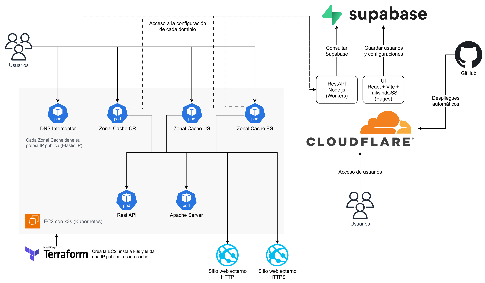
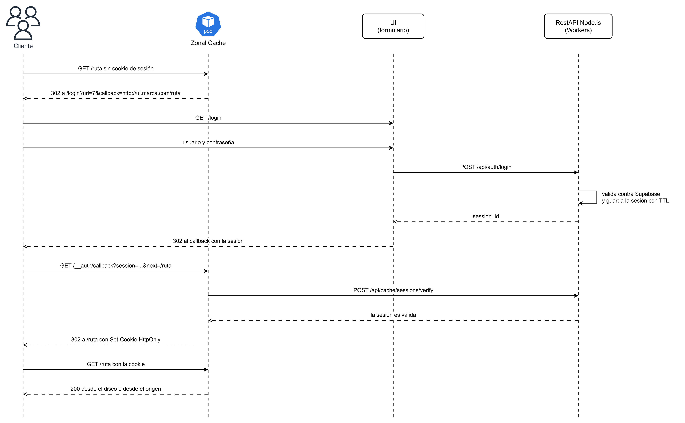

# Proxy/Caché con Geolocalización - Proyecto 2

Proxy/caché de aplicación con geolocalización para el curso Redes (IC-7602), Instituto Tecnológico de Costa Rica, II Semestre 2026.

**Profesor:** Ing. Gerardo Nereo Campos Araya \
**Entrega:** 09/11/26 \
**Evaluación presencial:** 10/11/26

Un **DNS Interceptor** recibe las consultas DNS y, cuando el dominio está registrado, responde la IP de la **Zonal Cache** más cercana al país del cliente. La caché valida la seguridad que pida esa URL (API Key o usuario y contraseña), busca el recurso en su disco y, si no lo tiene, lo trae del origen, lo guarda y lo sirve. Los dominios, URLs y credenciales se administran desde una **UI** y se consultan mediante un **REST API en Node.js**. Detrás de las cachés hay cuatro orígenes de prueba: un **REST API en Java**, un **Apache**, un sitio externo HTTP y uno HTTPS.

El enunciado está en [docs/especificacion/2026-02-IC7602-P2.md](docs/especificacion/2026-02-IC7602-P2.md), junto al PDF original.

---

## 1. Integrantes

| Carné | Nombre completo | Correo |
| --- | --- | --- |
| 2024145458 | Allan David Bolaños Barrientos | a.bolanos.2@estudiantec.cr |
| 2023047710 | Santiago Chaves Garbanzo | sanchaves@estudiantec.cr |
| 2023044780 | Alonso Durán Muñoz | alduran@estudiantec.cr |
| 2023057623 | Ana Isabel Hernández Muñoz | anahernandez@estudiantec.cr |
| 2024080534 | José Fabián Zumbado Ruiz | j.zumbado.1@estudiantec.cr |

---

## 2. Stack

El enunciado pide Firebase y Vercel. Usamos **Supabase** y **Cloudflare**, que el profesor permitió en la clase del 06/10. Supabase aporta PostgreSQL, Supabase Auth para las cuentas de la UI, RLS y la tabla IP-to-Country que ya teníamos del P1. Cloudflare tiene plan gratuito con deploy automático desde GitHub: Pages para la UI y Workers para el REST API.

| Componente | Elección |
| --- | --- |
| DNS Interceptor | GNU C (C17), sockets UDP POSIX y `pthread`. ldns para los mensajes DNS; libcurl y cJSON para consultar el REST API |
| Zonal Cache | GNU C (C17), sockets TCP POSIX, `pthread`, OpenSSL para SSL termination, libcurl para traer el recurso del origen y cJSON para la configuración |
| REST API Node.js | TypeScript con Hono sobre Cloudflare Workers y `supabase-js`. Hono corre igual sobre Node.js, por si hubiera que moverlo |
| UI | React, Vite y Tailwind CSS con TypeScript, en Cloudflare Pages, generada con ayuda de IA |
| Base de datos y cuentas | Supabase: PostgreSQL y Supabase Auth, con migraciones en `supabase/migrations/` |
| REST API de prueba | Java 21 con Javalin |
| Apache Server | Imagen oficial `httpd:2.4` con un sitio estático (HTML, CSS, JS y una imagen) |
| Pruebas de C | Criterion |
| Contenedores | Dockerfiles multietapa: una etapa compila y la imagen final solo lleva el binario |
| Despliegue | k3s en una EC2 de AWS con un Helm Chart propio en `helm/`. El REST API Node.js y la UI se despliegan solos en Cloudflare con cada merge a `main` |
| Infraestructura | Terraform en `terraform/`: la EC2, k3s y una Elastic IP por caché zonal |
| Automatización | Justfile en la raíz |

Decisiones que condicionan el resto:

- **El Interceptor se reescribe en C.** El del P1 está en Rust y el enunciado pide GNU C. Se conserva su diseño ([dns-interceptor.md del P1](https://github.com/JoseZum/2026-02-2024080534-IC7602-P1/blob/main/docs/03-arquitectura/dns-interceptor.md)), pero ahora solo importa la política geolocalizada y lo que no es nuestro se reenvía por UDP directo a un DNS externo.
- **Ningún componente de Kubernetes habla con Supabase.** El Interceptor y las cachés preguntan todo al REST API Node.js, como explicó el profesor. Así ninguna llave de Supabase vive en el clúster.
- **La UI sí usa Supabase para su CRUD**, protegida con RLS, como en el diagrama del enunciado. Solo llama al REST API para lo que necesita privilegios, como verificar un registro TXT.
- **El REST API se autentica con API Keys, cada una con su alcance.** La de la UI solo abre la verificación TXT y el login. No son las `x-api-key` que cada persona crea en la UI para proteger sus URLs: esas las manda el cliente final a la caché.
- **Una sola imagen de caché, varias zonas.** Cada zona es una instancia de la misma imagen con un `CACHE_ZONE` distinto (`CR`, `US`, `ES`, `GB`), y Terraform le da a cada una su Elastic IP.
- **Kubernetes en AWS, sin EKS.** Una sola EC2 con k3s. EKS cobra el plano de control aparte y complica darle una IP fija a cada caché.
- **Nada quemado en el código.** Puertos, URLs, llaves, zona, directorio de la caché y DNS externo entran por variables de entorno.

---

## 3. Estructura de carpetas

```
2026-02-2024080534-IC7602-P2/
├── README.md
├── justfile
├── docs/
│   ├── especificacion/           El enunciado en PDF y en Markdown
│   ├── 01-instalacion/           Guía de instalación
│   ├── 02-uso/                   Cómo usar la UI y probar con nslookup y curl
│   ├── 03-arquitectura/          Un documento por componente
│   ├── 04-estado-tareas/         Tareas, responsables y evidencia
│   ├── 05-pruebas/               Pruebas realizadas y cómo reproducirlas
│   ├── 06-conclusiones/          Conclusiones y recomendaciones
│   ├── 07-funcionalidades/       Tabla de qué funciona y qué no
│   ├── diagramas/                Fuentes .drawio y sus .png
│   ├── pdf/                      PDF generados por `just docs`
│   ├── reportes/                 Reportes de avance P2R1 a P2R5
│   ├── video/                    Enlace del video
│   └── documentacion-final.md    Toda la documentación unida
├── src/
│   ├── interceptor/              DNS Interceptor en GNU C
│   ├── zonal-cache/              Zonal Cache en GNU C
│   ├── node-api/                 REST API Node.js en Cloudflare Workers
│   ├── ui/                       React + Vite + Tailwind en Cloudflare Pages
│   ├── java-api/                 REST API de prueba en Java
│   └── apache/                   Sitio estático de prueba
├── supabase/                     Migraciones, datos de prueba y pruebas de RLS
├── helm/                         Chart: Interceptor, cachés zonales, API Java y Apache
├── terraform/                    EC2 con k3s, una Elastic IP por zona y el security group
└── scripts/                      Certificados, PDF y pruebas de despliegue
```

---

## 4. Cómo ejecutarlo

Con las credenciales de AWS y las variables de `.env` (ver `.env.example`):

```bash
git clone https://github.com/JoseZum/2026-02-2024080534-IC7602-P2.git
cd 2026-02-2024080534-IC7602-P2
just infra
just up
```

`just infra` crea con Terraform la EC2 con k3s y las Elastic IP. `just up` construye las imágenes, las publica en ECR e instala el Helm Chart. Hay que tener Docker, Terraform, la AWS CLI, `kubectl`, `helm` y `just`; todo lo demás se compila dentro de contenedores. La EC2 cobra mientras existe, por eso `just infra-down` la destruye. La guía con requisitos, variables de entorno y solución de problemas está en [docs/01-instalacion/README.md](docs/01-instalacion/README.md).

| Comando | Qué hace |
| --- | --- |
| `just infra` | Crea la EC2 con k3s y las Elastic IP, y deja el `kubeconfig` en `terraform/kubeconfig` |
| `just infra-down` | Destruye todo lo creado en AWS |
| `just up` | Prepara la CA, construye y publica las imágenes en ECR, instala el chart y deja las Elastic IP en la tabla `zones` |
| `just down` | Desinstala el release de Helm |
| `just test` | Pruebas de Criterion del Interceptor y la caché, y de JUnit del API Java |
| `just integracion` | Prueba de punta a punta con los cuatro orígenes contra las IP públicas |
| `just db` | Aplica las migraciones y los datos de prueba en Supabase |
| `just docs` | Compila Markdown a PDF en `docs/pdf/` |

`just` sin argumentos lista todas las recetas.

---

## 5. Arquitectura



Cada diagrama de `docs/diagramas/` tiene su fuente `.drawio` y su exportación `.png`. La descripción de cada componente está en `docs/03-arquitectura/`.

### Recorrido de una petición

1. El cliente pregunta por `www.marca.com`. El Interceptor revisa el mensaje y, si es una consulta `A` estándar, le pregunta al REST API Node.js si el nombre coincide con una URL bajo un dominio verificado. Un patrón exacto solo cubre ese host; `*.marca.com` cubre el raíz y sus subdominios. Sin coincidencia, reenvía el mensaje al DNS externo y le devuelve la respuesta al cliente sin tocarla.
2. Si coincide, el REST API ubica el país del cliente con IP-to-Country y devuelve la IP de la primera caché cuyo arreglo `zones.countries` incluya ese país. El Interceptor arma el response `A` con esa IP. Si no se conoce el país o no tiene zona, el API devuelve error y el Interceptor responde `SERVFAIL`.
3. El cliente se conecta a esa caché. La caché busca la URL configurada para el `Host` (la exacta gana a la wildcard). Si no hay ninguna, responde `404`.
4. Si la URL pide seguridad, se valida antes de tocar el disco:
   - **API Key:** sin header `x-api-key`, o con una llave que el REST API no reconoce, se responde `401`.
   - **Usuario y contraseña:** si la petición no trae una cookie de sesión válida, se responde `302` hacia el formulario de la UI, con la URL original como `callback`.
5. Si el recurso está en disco y no expiró, se sirve desde ahí.
6. Si no, se trae del origen. Si es cacheable se guarda, ejecutando el algoritmo de reemplazo de esa URL cuando no cabe, y se sirve al cliente.

### Flujo de usuario y contraseña



La sesión no puede viajar en una cookie de la UI, porque una cookie de un dominio no se puede leer desde otro. Por eso la UI la devuelve en el `callback` y es la caché la que la convierte en cookie de su propio dominio.

### Contratos

**Cadena de una petición dentro de la caché.** `servidor.c` llama a estas funciones en este orden y es el único archivo que conoce las cuatro:

```c
// config.h
const UrlConfig *config_buscar(const char *host);                               // NULL si no hay URL para ese Host
void config_soltar(const UrlConfig *url);                                       // solo servidor.c, al terminar la petición

// auth.h
int auth_verificar(const UrlConfig *url, const Peticion *p, Respuesta *salida); // 0 si pasa, -1 si ya dejó un 401 o un 302 en salida

// cache.h
int  cache_buscar(const UrlConfig *url, const Peticion *p, Respuesta *salida);  // 0 si hubo hit vigente, -1 si no
void cache_guardar(const UrlConfig *url, const Peticion *p, const Respuesta *r); // decide si es cacheable y reemplaza si no cabe

// origen.h
int origen_traer(const UrlConfig *url, const Peticion *p, Respuesta *salida);   // 0 si el origen respondió, -1 si hay que dar 502
```

**Rutas del REST API Node.js:**

| Ruta | La consume | Autenticación |
| --- | --- | --- |
| `GET /api/interceptor/resolve?domain=&client_ip=` | DNS Interceptor | Llave de componente |
| `GET /api/cache/config` | Zonal Cache | Llave de componente |
| `POST /api/cache/api-keys/verify` | Zonal Cache | Llave de componente |
| `POST /api/cache/sessions/verify` | Zonal Cache | Llave de componente |
| `POST /api/auth/login` y `POST /api/auth/logout` | Formulario de la UI | Llave de la UI; adentro van el usuario y contraseña de la URL, o la sesión |
| `POST /api/domains/:id/verify` | UI | Llave de la UI |

Respuesta de `GET /api/interceptor/resolve?domain=www.marca.com&client_ip=81.2.69.160`:

```json
{ "exists": true, "zone": "GB", "address": "203.0.113.24" }
```

Si el nombre no coincide con ningún patrón de URL bajo un dominio verificado, la misma ruta responde con HTTP `200` y `{ "exists": false }`, y el Interceptor reenvía la consulta al DNS externo.

Respuesta de `GET /api/cache/config`:

```json
{
  "urls": [
    {
      "id": 7,
      "pattern": "api.marca.com",
      "tls_enabled": true,
      "origin": "http://java-api:8080",
      "cache_size_bytes": 1048576,
      "replacement_policy": "lru",
      "auth": "api_key",
      "file_types": [ { "extension": "json", "ttl_seconds": 30 } ]
    }
  ]
}
```

La caché carga toda la configuración al arrancar y la vuelve a pedir cada `CONFIG_REFRESH_SECONDS`. Las API Keys y contraseñas se guardan con hash y nunca salen de Supabase: la caché solo pregunta si una es válida.

### Decisiones de diseño

| Pregunta | Decisión |
| --- | --- |
| ¿Cómo se prueba la geolocalización? | Se llama a `GET /api/interceptor/resolve` con IP de distintos países en `client_ip`. El Interceptor usa la IP de quien le envió el paquete, sin mecanismos para simular países |
| ¿Cómo llega el cliente a cada caché? | Terraform le da a cada caché una IP privada secundaria en la EC2 y una Elastic IP asociada. Su `Service` escucha la IP privada con `externalIPs`, porque AWS traduce la Elastic IP a la privada antes de que el paquete llegue al nodo. El registro `A` apunta a la Elastic IP en el puerto 80 o 443 |
| ¿El tamaño máximo es por dominio o por URL? | Por URL, con su propio directorio, porque la UI define el tamaño por URL. Un dominio con una sola URL `*.dominio` equivale a un límite por dominio |
| ¿Cómo se registran los sitios externos si no podemos crear su TXT? | Se cargan como verificados desde los datos de prueba. La verificación TXT se probó con un dominio gratuito de FreeDNS o DuckDNS |
| ¿Qué código se usa para mandar al formulario? | `302`: el navegador guarda un `301` como permanente y seguiría redirigiendo aunque ya exista la sesión |
| ¿Qué se guarda en caché? | Solo `GET` con `200` cuyo tipo esté entre los de la URL: se toma la extensión y, si la ruta no tiene, el `Content-Type`. Nada con `Cache-Control: private` o `no-store`, ni con `Set-Cookie`. Un recurso más grande que el límite se sirve sin guardar |
| ¿La caché sobrevive a un reinicio del pod? | No: el disco es un `emptyDir` y la caché arranca vacía. El enunciado no pide persistencia |
| ¿Cuándo se borran los expirados? | Un hilo los purga cada `PURGE_INTERVAL_SECONDS`, y además se sacan primero cuando hace falta espacio |
| ¿Cómo presenta la caché un certificado válido para un sitio HTTPS que no es nuestro? | Genera bajo demanda un certificado por patrón habilitado para TLS, firmado con la CA local compartida, y lo escoge por SNI. El cliente confía en la CA con `curl --cacert` |
| ¿Cloudflare Workers cuenta como "REST API en Node.js"? | Workers corre TypeScript con `nodejs_compat`, que no es Node.js como tal; por eso el API usa Hono, que corre igual sobre Node.js |

---

## 6. Documentación

| Qué | Dónde |
| --- | --- |
| Toda la documentación unida | [docs/documentacion-final.md](docs/documentacion-final.md) |
| Instalación | [docs/01-instalacion](docs/01-instalacion/README.md) |
| Uso | [docs/02-uso](docs/02-uso/README.md) |
| Arquitectura de cada componente | [docs/03-arquitectura](docs/03-arquitectura) |
| Pruebas | [docs/05-pruebas](docs/05-pruebas/README.md) |
| Conclusiones y recomendaciones | [docs/06-conclusiones](docs/06-conclusiones/README.md) |
| Qué funciona y qué no | [docs/07-funcionalidades](docs/07-funcionalidades/README.md) |
| Reportes de avance | [docs/reportes](docs/reportes) |
| Código | `src/interceptor/`, `src/zonal-cache/`, `src/node-api/`, `src/ui/`, `src/java-api/`, `src/apache/`, `supabase/`, `helm/` y `terraform/` |

---

## 7. Uso de IA

Conforme a la sección 11 de la Política para el Uso de Inteligencia Artificial Generativa del curso, cada integrante declara lo que corresponde a su trabajo.

### José Fabián Zumbado Ruiz (2024080534)

**Qué herramientas se utilizaron.** ChatGPT y Claude, incluido Claude Code.

**Para qué se utilizaron.** Una vez planteadas distintas soluciones para la arquitectura y herramientas se utilizó ChatGPT para ayudar en la comparación, sin embargo la decisión final fue tomada por el equipo. Con Claude Code se migró código del P1 a este proyecto y se adaptó (lo migrado está en la tabla "Código tomado del P1" de [zonal-cache.md](docs/03-arquitectura/zonal-cache.md)). Los documentos Markdown se hicieron con apoyo de IA, pero la información venía del equipo: se redactaron en conjunto con la IA y se revisó todo.

**Qué partes se generaron con apoyo de IA.** El código migrado del P1 y adaptado, y los documentos Markdown de `docs/` y este README.

**Qué modificaciones se realizaron.** Todo lo generado se revisó y se adaptó antes de usarlo.

**Qué se aprendió.** Cómo funciona el sistema completo y las librerías de C que usa.
