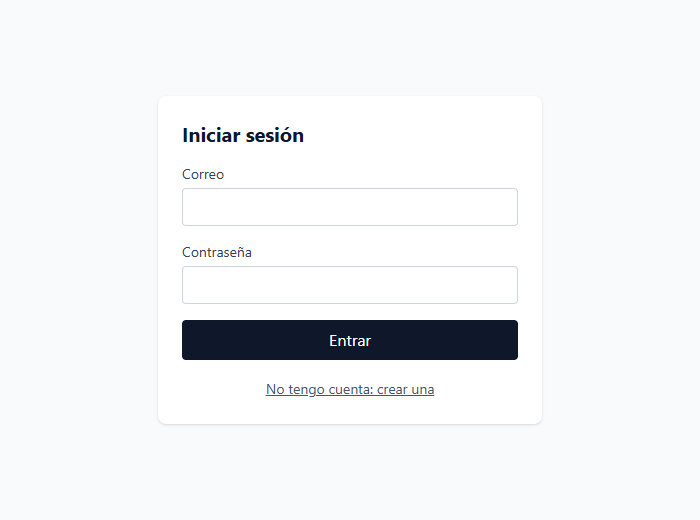
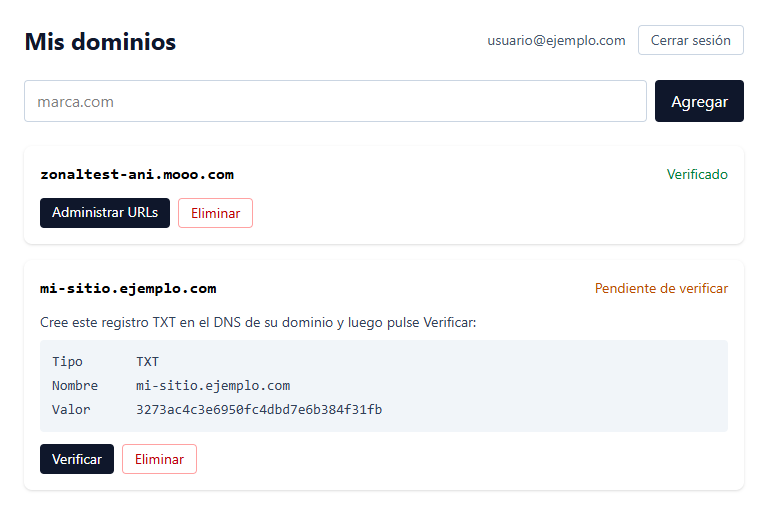
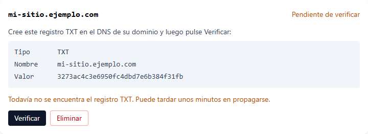
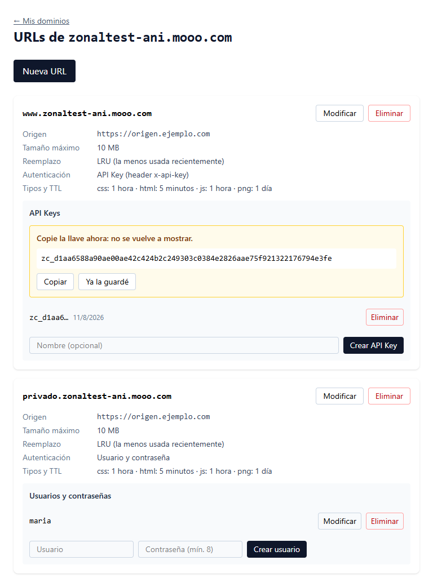
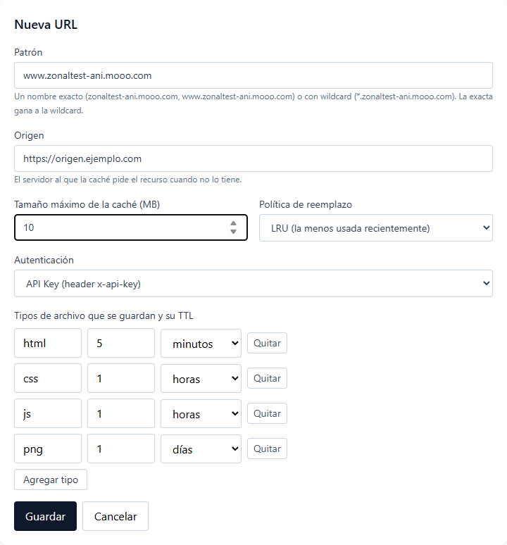
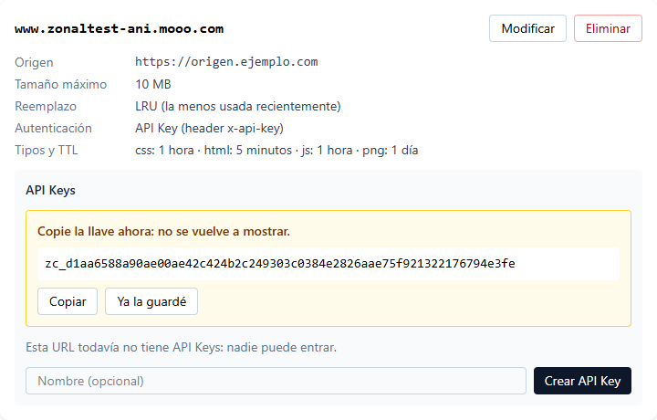
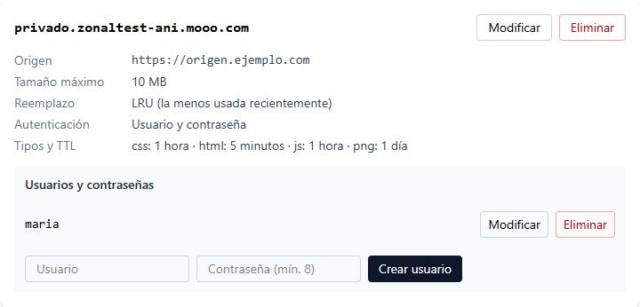
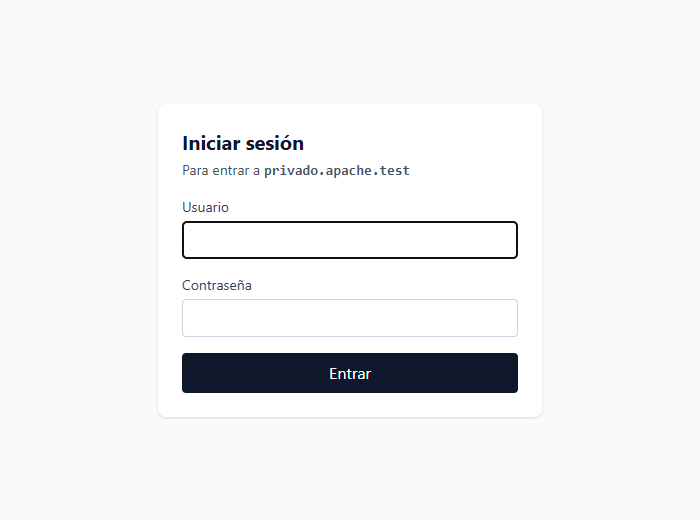
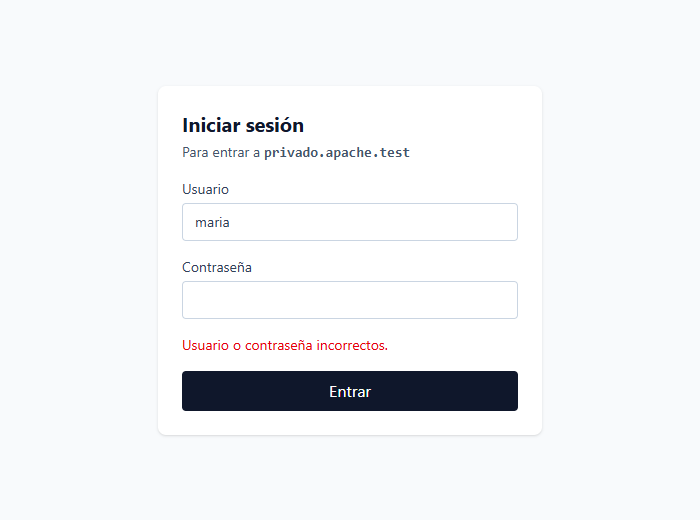
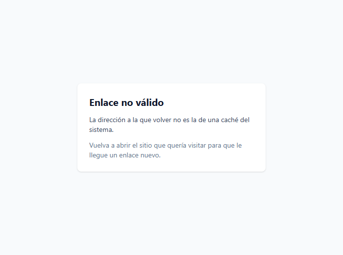

# Guía de uso

Esta guía explica cómo usar el sistema una vez instalado: cómo registrarse, dar de alta un dominio, configurar sus URLs y protegerlas, y cómo comprobar con `nslookup` y `curl` que todo funciona. Está pensada para alguien con conocimientos básicos de computación; no hace falta haber leído el código. Para instalar el sistema primero, vea la [guía de instalación](../01-instalacion/README.md).

La interfaz web está en **https://zonal-ui.pages.dev**.

## 1. Qué hace el sistema, en pocas palabras

Usted tiene un sitio web en algún servidor, que llamaremos su **origen**. El sistema se pone delante de él para que las visitas lo reciban más rápido y desde más cerca:

1. En la **interfaz web** usted registra su dominio (por ejemplo `marca.com`) y configura qué direcciones atiende (`www.marca.com`, `*.marca.com`), de dónde trae el contenido (su origen), cuánto guarda en disco, por cuánto tiempo y si pide contraseña.
2. Cuando alguien visita `www.marca.com`, su computadora le pregunta la IP al **DNS Interceptor**, que responde la IP de la **caché zonal** más cercana al país de esa persona.
3. La **caché zonal** revisa si ya tiene el archivo guardado. Si lo tiene (un *hit*) lo entrega sin molestar al origen; si no (un *miss*), lo pide al origen, lo guarda y lo entrega.

Usted solo trabaja en el paso 1. Los pasos 2 y 3 ocurren solos, y la sección 7 muestra cómo verlos.

## 2. Crear una cuenta e iniciar sesión

Abra https://zonal-ui.pages.dev. Sin sesión, la página lo lleva a **Iniciar sesión**:



Si todavía no tiene cuenta, pulse **No tengo cuenta: crear una**, escriba su correo y una contraseña de al menos 6 caracteres y pulse **Crear cuenta**:


El sistema le manda un correo de confirmación. **Abra el enlace del correo** antes de iniciar sesión; sin eso, la pantalla le dirá que el correo o la contraseña son incorrectos. Después vuelva a la pantalla de inicio de sesión, escriba sus datos y pulse **Entrar**.

Para salir, pulse **Cerrar sesión**, arriba a la derecha de la pantalla *Mis dominios*.

## 3. Registrar y verificar un dominio

La pantalla **Mis dominios** lista sus dominios y permite agregar más:



### 3.1 Agregar el dominio

Escriba el dominio, sin `http://` ni `www`, y pulse **Agregar**. Debe estar en minúsculas, llevar un punto y usar solo letras, números y guiones. Por ejemplo: `marca.com`. Si lo escribe con mayúsculas, el sistema lo pasa a minúsculas.

El dominio queda como **Pendiente de verificar**. El sistema no confía en que sea suyo hasta que usted lo demuestre.

### 3.2 Demostrar que el dominio es suyo (registro TXT)

La tarjeta del dominio pendiente muestra tres datos:

| Dato | Qué es | En el ejemplo |
| --- | --- | --- |
| Tipo | El tipo de registro DNS que hay que crear | `TXT` |
| Nombre | El dominio donde se crea | `mi-sitio.ejemplo.com` |
| Valor | Un código único que el sistema generó para ese dominio | `3273ac4c3e6950fc4dbd7e6b384f31fb` |

Entre al panel donde administra el DNS de su dominio (su registrador o su proveedor de DNS, por ejemplo FreeDNS o DuckDNS) y cree un registro **TXT** en ese nombre con ese valor. El valor va tal cual, con una excepción: **algunos paneles, como FreeDNS, exigen escribirlo entre comillas dobles** (`"3273ac4c3e6950fc4dbd7e6b384f31fb"`). Las comillas dobles son el formato del registro TXT, no forman parte del código. Con comillas simples (`'...'`) el panel lo rechaza o lo guarda mal.

Un registro nuevo puede tardar de unos minutos a un rato en verse en internet. Para ver si ya está publicado:

```bash
nslookup -type=TXT mi-sitio.ejemplo.com 1.1.1.1
```

Cuando aparezca el valor (`text = "3273ac4c3e6950fc4dbd7e6b384f31fb"`), pulse **Verificar** en la tarjeta.

### 3.3 Qué responde Verificar

- **Verificado** (en verde): el sistema encontró su código en el DNS. Ya puede crear URLs en ese dominio.
- **"Todavía no se encuentra el registro TXT. Puede tardar unos minutos en propagarse."**:

  

  No es un error: el registro aún no existe o aún no se propaga. Revise con `nslookup` y vuelva a intentar en unos minutos. Si acaba de consultarlo antes de crearlo, algunos servidores DNS recuerdan la respuesta negativa un rato.
- **Un mensaje de error del DNS**: el servicio que consulta el DNS no respondió. Vuelva a intentarlo.

Una vez verificado, el registro TXT ya no se vuelve a consultar. Puede dejarlo en su DNS.

### 3.4 Eliminar un dominio

Pulse **Eliminar** y confirme. Se borran también sus URLs, API Keys y usuarios, y esto no se puede deshacer.

## 4. Crear las URLs de un dominio

En un dominio verificado, pulse **Administrar URLs**. Una URL del sistema es un *nombre de host* (por ejemplo `www.marca.com`) con su configuración de caché. La pantalla lista las del dominio y permite crear más:



Pulse **Nueva URL** para ver el formulario:



### 4.1 Qué significa cada campo

| Campo | Qué poner | Ejemplo |
| --- | --- | --- |
| **Patrón** | El nombre que atiende esta URL. Debe ser el dominio o un subdominio suyo. Admite un `*.` al inicio para atender muchos nombres | `www.marca.com`, `*.marca.com` |
| **Origen** | La dirección del servidor de donde la caché trae el contenido cuando no lo tiene. Debe empezar con `http://` o `https://` | `https://origen.marca.com` |
| **Tamaño máximo de la caché (MB)** | Cuánto disco puede ocupar esta URL. Nunca se pasa de ahí | `10` |
| **Política de reemplazo** | Qué se descarta cuando la caché se llena y llega algo nuevo (ver abajo) | LRU |
| **Autenticación** | Quién puede entrar: nadie en particular, quien tenga una API Key o quien tenga usuario y contraseña (sección 5) | Sin autenticación |
| **Tipos de archivo y TTL** | Qué tipos se guardan y por cuánto tiempo | `png`, 1 día |

**Wildcards.** El `*.` cubre el dominio raíz y los subdominios de cualquier profundidad:

| Patrón | Atiende | No atiende |
| --- | --- | --- |
| `*.marca.com` | `marca.com`, `www.marca.com`, `a.b.marca.com` | `otramarca.com`, `marca.com.otro.com` |
| `www.marca.com` | solo `www.marca.com` | `api.marca.com` |

Si varias URLs calzan con un nombre, gana la más específica: la exacta le gana a la wildcard, y `*.api.marca.com` le gana a `*.marca.com` para `v1.api.marca.com`.

**Tipos de archivo y TTL.** La caché solo guarda los tipos de archivo de esta lista, y cualquier otro lo pide siempre al origen. Escriba la extensión sin punto (`png`, `html`, `css`, `js`) y por cuánto tiempo se considera vigente (*TTL*), en segundos, minutos, horas o días. Pasado ese tiempo, el archivo se descarta y se vuelve a pedir al origen. Cada tipo puede tener su propio TTL: por ejemplo, `html` 5 minutos y `png` 1 día. El botón **Agregar tipo** añade una fila y **Quitar** la borra; debe quedar al menos una.

**Política de reemplazo.** Cuando el disco asignado a la URL se llena, la caché saca archivos hasta que cabe el nuevo:

| Política | Saca primero |
| --- | --- |
| LRU | El que hace más tiempo que nadie pide |
| LFU | El que menos veces se ha pedido |
| FIFO | El que entró primero |
| MRU | El que se pidió más recientemente |
| Aleatoria | Uno cualquiera |

Si no sabe cuál escoger, LRU es la opción habitual.

### 4.2 Modificar y eliminar una URL

En la tarjeta de cada URL, **Modificar** abre el mismo formulario con sus datos; **Eliminar** la borra con sus tipos de archivo y credenciales. La caché toma los cambios sola, **hasta 30 segundos después** de guardarlos con la configuración por defecto: no hace falta reiniciar nada.

## 5. Proteger una URL

Con **Autenticación** puede exigir que quien visite la URL se identifique. Hay dos mecanismos, y cada tarjeta muestra el panel del que usted escogió. Si cambia el mecanismo de una URL, las credenciales del anterior no se borran, pero la caché solo usa las del nuevo.

### 5.1 API Key (el cliente manda un header `x-api-key`)

Pensada para programas: el cliente manda su llave en un header HTTP. En la tarjeta, pulse **Crear API Key** (opcionalmente con un nombre para recordar de quién es):



> **Copie la llave en ese momento.** Se muestra una sola vez. El sistema guarda solo una huella de ella, no la llave, así que nadie, ni usted, puede volver a verla. Si la pierde, elimínela y cree otra.

La lista muestra solo el principio de cada llave (`zc_d1aa6…`) para que las reconozca. **Eliminar** una llave corta el acceso de quien la use, de inmediato. Las API Keys no se modifican: se crean y se eliminan.

### 5.2 Usuario y contraseña

Pensada para personas con navegador. En la tarjeta escriba un usuario y una contraseña de **al menos 8 caracteres** y pulse **Crear usuario**:



**Modificar** permite cambiar el nombre de usuario y la contraseña; si deja la contraseña vacía, se conserva la anterior. **Eliminar** borra al usuario y cierra sus sesiones abiertas. Las contraseñas se guardan cifradas y no se pueden leer, ni siquiera desde esta pantalla.

## 6. Qué ve quien visita una URL con usuario y contraseña

Usted no tiene que construir ningún formulario. Cuando alguien visita una URL protegida sin haber iniciado sesión, la caché lo manda a la página `/login` de esta interfaz, que le muestra a qué sitio va a entrar:



Si la contraseña es incorrecta, lo dice y se queda en el formulario:



Si son correctas, la persona vuelve automáticamente a la dirección que quería visitar, y no tiene que escribir nada más mientras dure su sesión (una hora, por defecto). Un enlace a esta página que no trae la información de una caché del sistema muestra "Enlace no válido" y no pide la contraseña:



## 7. Probar el sistema con `nslookup` y `curl`

Estas pruebas muestran cada pieza funcionando por fuera de la interfaz. Hacen falta `nslookup` y `curl`, que vienen en macOS y Linux y en Windows 10 y 11 (en Windows PowerShell escriba `curl.exe`, porque `curl` es otro comando). Los ejemplos están en `bash`. La lista completa de pruebas del proyecto está en [docs/05-pruebas](../05-pruebas/README.md#4-cómo-reproducir-cada-prueba-a-mano).

### 7.1 Preparar

Con el sistema instalado, guarde la IP del DNS Interceptor (la imprime `just infra`):

```bash
INTERCEPTOR=$(terraform -chdir=terraform output -raw ip_interceptor)
```

Los ejemplos usan los sitios de prueba que ya vienen cargados (`java-api.test`, `seguro.java-api.test`, `privado.apache.test`). Para probar **su propio** dominio, cambie esos nombres por los suyos (sección 7.6).

### 7.2 El DNS Interceptor responde la IP de la caché

```bash
nslookup java-api.test $INTERCEPTOR
```

```
Name:	java-api.test
Address: 3.214.10.5
```

Esa `Address` es la IP de la caché de la zona de su país. Guárdela:

```bash
CACHE=3.214.10.5
```

Un nombre que cae en una de sus wildcards responde igual, y uno que no es del sistema se reenvía al DNS de siempre:

```bash
nslookup seguro.java-api.test $INTERCEPTOR     # registrado: la IP de la caché
nslookup example.com $INTERCEPTOR              # no es nuestro: la IP real de example.com
```

### 7.3 La caché guarda lo que ya pidió (miss y hit)

Con `--resolve`, `curl` le dice a qué IP ir sin tocar la configuración de su computadora. Pida lo mismo dos veces:

```bash
curl -i --resolve java-api.test:80:$CACHE http://java-api.test/api/productos
curl -i --resolve java-api.test:80:$CACHE http://java-api.test/api/productos
```

La primera respuesta viene del origen y **no** trae el header `X-Cache`. La segunda salió del disco de la caché y trae:

```
X-Cache: HIT
```

Si un nombre no tiene URL configurada, la caché responde `404`:

```bash
curl -i --resolve otro.test:80:$CACHE http://otro.test/
```

### 7.4 URL con API Key

Sin llave y con una llave inválida la caché responde `401`, y no pide nada al origen; con la correcta, `200`:

```bash
curl -i --resolve seguro.java-api.test:80:$CACHE http://seguro.java-api.test/api/productos
curl -i --resolve seguro.java-api.test:80:$CACHE -H 'x-api-key: no-sirve' http://seguro.java-api.test/api/productos
curl -i --resolve seguro.java-api.test:80:$CACHE -H 'x-api-key: dev-java-key' http://seguro.java-api.test/api/productos
```

Con una URL suya, use la llave que copió en la sección 5.1.

### 7.5 URL con usuario y contraseña

Sin sesión, la caché responde `302` y manda al formulario de la interfaz (la `Location` incluye el `callback` al que se vuelve después de entrar):

```bash
curl -i --resolve privado.apache.test:80:$CACHE http://privado.apache.test/
```

Desde un navegador este recorrido es automático (sección 6). Para verlo paso a paso con `curl`, inicie sesión en el API (la llave `ui` de los datos de prueba es `dev-ui-key`; `$NODE_API_URL` es la dirección del API de Cloudflare de su `.env`) y use la sesión que devuelve:

```bash
SES=$(curl -s -X POST $NODE_API_URL/api/auth/login \
  -H 'x-api-key: dev-ui-key' -H 'content-type: application/json' \
  -d '{"url_id":4,"username":"alonso","password":"apache-1234"}' | sed 's/.*"session":"\([^"]*\)".*/\1/')

# la caché valida la sesión y la deja en una cookie, y vuelve a "/"
curl -i --resolve privado.apache.test:80:$CACHE \
  "http://privado.apache.test/__auth/callback?next=%2F&session=$SES"

# con esa cookie la caché ya deja pasar
curl -i --resolve privado.apache.test:80:$CACHE -b "zc_session=$SES" http://privado.apache.test/
```

El segundo comando responde `302` hacia `/` con un `Set-Cookie: zc_session=…`, y el tercero `200`. Una contraseña incorrecta en el primer comando responde `401` y no devuelve sesión.

### 7.6 Probar su propio dominio de punta a punta

1. Registre y verifique el dominio (sección 3).
2. Cree una URL, por ejemplo `www.su-dominio.com`, con su origen y un tipo `html` (sección 4). Espere hasta 30 segundos a que la caché tome el cambio.
3. Pregunte al Interceptor: `nslookup www.su-dominio.com $INTERCEPTOR` debe responder la IP de una caché.
4. Pida una página dos veces: `curl -i --resolve www.su-dominio.com:80:$CACHE http://www.su-dominio.com/index.html`. La segunda trae `X-Cache: HIT`.

Para que las visitas reales lleguen al sistema, el DNS público de su dominio debe apuntar su nombre al DNS Interceptor; eso se configura en su proveedor de DNS y queda fuera del alcance de esta guía.

## 8. Problemas comunes

| Síntoma | Causa probable | Qué hacer |
| --- | --- | --- |
| Al iniciar sesión dice "Correo o contraseña incorrectos" con una cuenta recién creada | No confirmó el correo | Abra el enlace del correo de confirmación y vuelva a intentar |
| No llega el correo de confirmación | Está en la carpeta de spam, o el servicio limita los envíos | Revise el spam y espere unos minutos antes de pedirlo otra vez |
| "Escriba un dominio válido" | Tiene mayúsculas raras, `http://`, espacios, o no lleva punto | Escriba solo `marca.com` |
| "Ese dominio ya está registrado" | Alguien ya lo registró, o usted mismo antes | Use otro dominio, o elimine el anterior si era suyo |
| Verificar dice que no encuentra el registro TXT | El registro no existe, está mal escrito o aún no se propaga | Compruebe con `nslookup -type=TXT su-dominio 1.1.1.1` que el valor es exactamente el de la tarjeta |
| Al crear la URL: "El patrón debe ser … o un subdominio suyo" | El patrón es de otro dominio | Use `su-dominio.com`, `www.su-dominio.com` o `*.su-dominio.com` |
| "Ya existe una URL con ese patrón" | Otra URL (de cualquier cuenta) ya usa ese patrón | Use otro patrón o modifique la existente |
| La caché sigue respondiendo como antes de un cambio | La caché recarga la configuración cada 30 segundos | Espere un momento y repita |
| `curl` responde `404` | El nombre no coincide con ninguna URL configurada | Revise el patrón, y que el nombre del `--resolve` sea el mismo del patrón |
| `curl` responde `401` en una URL con API Key | Falta el header `x-api-key`, o la llave es de otra URL o fue eliminada | Cree una llave nueva en esa URL |
| `curl` responde `502` | La caché no puede llegar al origen | Revise que el origen esté encendido y que la dirección sea correcta |
| Una página nunca trae `X-Cache: HIT` | Su tipo de archivo no está en la lista de la URL, la respuesta no es un `200`, o el origen manda `Cache-Control: private`, `no-store` o `Set-Cookie` | Agregue el tipo en la URL; recuerde que solo se guardan las respuestas `GET` exitosas |
| `nslookup` responde la IP real y no la de la caché | El nombre no está registrado, o el dominio no está verificado | Compruebe que el dominio dice **Verificado** y que existe una URL que calce |
