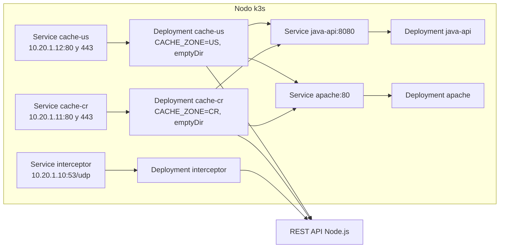

# Helm Chart

`helm/proxy-cache/` instala en el k3s de la EC2 todo lo que corre en Kubernetes: el DNS Interceptor, una Zonal Cache por cada zona, el REST API Java y el Apache. El REST API Node.js y la UI no van aquí porque corren en Cloudflare.



## Qué instala

| Objeto | Cuántos | Detalle |
| --- | --- | --- |
| `Deployment` y `Service` `interceptor` | 1 | El contenedor escucha en `interceptor.puerto` (5300) porque corre sin root; el `Service` expone el 53/udp en `interceptor.externalIPs` |
| `Deployment` y `Service` `cache-<zona>` | Uno por cada elemento de `cache.zonas` | La misma imagen con su `CACHE_ZONE`, su disco `emptyDir` con `sizeLimit` y su `Service` en la `externalIP` de la zona, puertos 80 y 443 hacia 8080 y 8443 |
| `Deployment` y `Service` `java-api` | 1 | El `Service` se llama `java-api` y escucha en 8080, igual que el origen `http://java-api:8080` de los datos de prueba |
| `Deployment` y `Service` `apache` | 1 | El `Service` se llama `apache` y escucha en 80, igual que `http://apache:80` |
| `Secret` `<release>-llaves` | 1 | Las llaves de componente del Interceptor y de las cachés hacia el REST API Node.js |
| `Secret` `<release>-ca` | 1 | La CA local (`rootCA.pem` y `rootCA-key.pem`) que monta cada caché en `/etc/zonal-cache` para el SSL termination |

### externalIPs y el IP del cliente

Cada `Service` que recibe tráfico de Internet usa `externalIPs` con la **IP privada** que Terraform le dio a esa zona en la EC2 (ver [infraestructura.md](infraestructura.md)). kube-proxy manda al pod lo que llegue a esa IP y ese puerto.

Esos `Service` llevan `externalTrafficPolicy: Local`. Sin eso kube-proxy cambia el IP de origen del paquete por el del nodo, y el Interceptor le preguntaría al REST API por el país del nodo en vez del país del cliente. Kubernetes solo acepta ese campo si el `Service` tiene `externalIPs`, así que el chart lo omite cuando la lista está vacía.

### Disco de la caché

Cada caché tiene un `emptyDir` montado en `cache.directorio`, que es su `CACHE_DIR`. El disco no sobrevive a un reinicio del pod, como decidimos en la T-05. `sizeLimit` es un tope de Kubernetes por encima del de la caché: si el pod lo pasara, Kubernetes lo sacaría. Tiene que ser mayor que la suma de `cache_size_bytes` de las URLs, que en los datos de prueba da unos 21 MB. Las cachés usan `strategy: Recreate` porque el índice vive en memoria y no tiene sentido tener dos pods de la misma zona.

### Actualizaciones

Los pods del Interceptor y de las cachés llevan un `checksum` de los `Secret` en sus anotaciones: si cambia una llave o la CA en un `helm upgrade`, se reinician con los valores nuevos.

## Valores

Nada queda quemado en las imágenes: cada componente recibe su configuración por variables de entorno que salen de `values.yaml` o de los `Secret`. Los que no tienen valor por defecto hacen fallar la instalación con un mensaje que dice qué falta.

| Valor | Por defecto | Qué es |
| --- | --- | --- |
| `imagenes.registro` | Vacío | Registro de las imágenes, por ejemplo el de ECR que da Terraform. Vacío usa solo el nombre |
| `imagenes.etiqueta` | `latest` | Etiqueta de las cuatro imágenes |
| `imagenes.pullPolicy` | `IfNotPresent` | |
| `imagenes.pullSecrets` | `[]` | Secrets `docker-registry`, por ejemplo `[{ name: ecr }]` |
| `nodeApi.url` | Obligatorio | URL del REST API Node.js; tiene que empezar con `http://` o `https://` |
| `nodeApi.timeoutSeconds` | `5` | `NODE_API_TIMEOUT_SECONDS` del Interceptor |
| `llaves.interceptor` y `llaves.cache` | Obligatorias | Llaves de componente, se pasan con `--set-string` |
| `llaves.secretoExistente` | Vacío | Un `Secret` ya creado con las llaves `interceptor` y `cache`, en lugar de las dos anteriores |
| `interceptor.externalIPs` | `[]` | IP privada principal del nodo |
| `interceptor.upstreamDns`, `upstreamDnsPort`, `upstreamTimeoutSeconds`, `dnsTtlSeconds` | `8.8.8.8`, `53`, `3`, `60` | Variables del Interceptor |
| `cache.zonas` | CR, US, ES y GB con `10.20.1.11` a `.14` | Lista de `{ codigo, externalIP }`. El código son dos letras en mayúscula y no se puede repetir |
| `cache.uiLoginUrl` | Obligatorio | Formulario de la UI para las URLs con usuario y contraseña |
| `cache.ca.cert` y `cache.ca.llave` | Obligatorios | La CA local, con `--set-file` |
| `cache.ca.secretoExistente` | Vacío | Un `Secret` ya creado con `rootCA.pem` y `rootCA-key.pem` |
| `cache.configRefreshSeconds` | `30` | Cada cuánto cada caché vuelve a pedir su configuración |
| `cache.purgeIntervalSeconds` | `60` | Para el purgado de expirados de la T-06 |
| `cache.tamanoDisco` | `1Gi` | `sizeLimit` del `emptyDir` |
| `javaApi.puerto` y `apache.puerto` | `8080` y `80` | Puerto del contenedor y de su `Service` |
| `*.habilitado` | `true` | Se puede apagar el Interceptor, el API Java o el Apache |
| `*.recursos` | `{}` | `resources` de cada contenedor |

## Uso

`just up` (T-25) arma los valores con las salidas de Terraform y llama a Helm. A mano sería así:

```bash
export KUBECONFIG=$PWD/terraform/kubeconfig
helm upgrade --install p2 helm/proxy-cache --namespace p2 --create-namespace \
    --set nodeApi.url=https://zonal-api.duran-munozalonso.workers.dev \
    --set cache.uiLoginUrl=https://<ui>/login \
    --set-string llaves.interceptor=<llave>,llaves.cache=<llave> \
    --set-file cache.ca.cert=.certs/rootCA.pem,cache.ca.llave=.certs/rootCA-key.pem \
    --set 'interceptor.externalIPs={10.20.1.10}' \
    --wait
helm uninstall p2 --namespace p2
```

## Pruebas

| Prueba | Cómo se corre | Qué revisa |
| --- | --- | --- |
| Lint | `helm lint --strict helm/proxy-cache -f helm/proxy-cache/tests/valores-prueba.yaml` | Que el chart arma YAML válido |
| Pruebas unitarias | `helm unittest helm/proxy-cache` (plugin [helm-unittest](https://github.com/helm-unittest/helm-unittest)) | `tests/*_test.yaml`: un `Deployment` y un `Service` por zona con su `CACHE_ZONE`; cada variable que leen `config.c` de la caché y del Interceptor; el `emptyDir` y la CA montados; `externalIPs` con `externalTrafficPolicy: Local` y sin él cuando no hay IP; los nombres `java-api` y `apache` de los orígenes; imágenes y puertos desde `values.yaml`; y los errores por zona repetida, código mal escrito, URL del API que no es HTTP y llaves, CA o formulario faltantes |
| Instalación en un k3s real | `NODE_API_URL=<url> sh scripts/probar-helm.sh` | Levanta `rancher/k3s` en Docker con IP de prueba que hacen de secundarias, carga las cuatro imágenes e instala el chart. Revisa que todo queda disponible, el Apache y el API Java por su `Service` y por la caché, un `HIT` en la segunda petición por la `externalIP` de una zona, el `401` sin `x-api-key`, HTTPS con la CA y que el Interceptor reenvía `example.com`. Después hace `helm upgrade` y revisa que los pods toman los valores nuevos, y `helm uninstall` y revisa que no queda nada |
