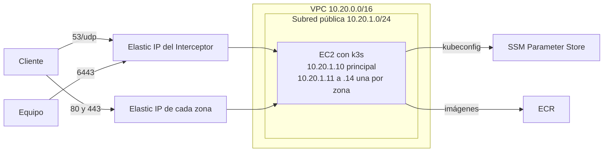

# Infraestructura en AWS con Terraform

`terraform/` crea en AWS todo lo que necesita la parte de Kubernetes: una EC2 con k3s, una IP pública fija por cada caché zonal y otra para el Interceptor, el security group, los repositorios de ECR para las imágenes y el `kubeconfig` para que Helm instale encima. No se hace nada a mano en la consola de AWS.



## Qué crea

| Recurso | Para qué |
| --- | --- |
| VPC, subred pública, Internet Gateway y tabla de rutas | Una red propia, sin depender de la VPC por defecto de la cuenta |
| Security group | Abre 53/udp, 80/tcp y 443/tcp a todo Internet y 6443/tcp (API de Kubernetes) solo a las IP de `ips_equipo`. La salida queda abierta para bajar k3s y las imágenes, y para llegar a los sitios externos y al REST API Node.js |
| EC2 con Amazon Linux 2023 | El único nodo de k3s. Por defecto `t3.medium` (2 vCPU y 4 GB) con 20 GB de disco `gp3` |
| Una IP privada secundaria por zona | En la misma interfaz de la EC2: `10.20.1.11` para la primera zona, `10.20.1.12` para la segunda y así |
| Elastic IP del Interceptor | Asociada a la IP principal `10.20.1.10`. Es la IP que se usa en `nslookup` y también la del API de Kubernetes |
| Una Elastic IP por zona | Asociada a la IP secundaria de esa zona. Es la que devuelve el Interceptor y la que va en la tabla `zones` de Supabase |
| Parámetro `/ic7602-p2/kubeconfig` en SSM | `SecureString` donde la EC2 deja el `kubeconfig` al terminar de instalar k3s |
| Cuatro repositorios de ECR | `ic7602-p2/interceptor`, `zonal-cache`, `java-api` y `apache`, donde `just up` publica las imágenes |
| Rol e instance profile | Solo dejan a la EC2 escribir ese parámetro. En AWS Academy no se crean (ver abajo) |

### Por qué una IP secundaria por zona

Cada caché zonal tiene que tener su propia IP pública, porque eso es lo que responde el Interceptor según el país. En una sola EC2 eso se logra con varias IP privadas en la misma interfaz y una Elastic IP asociada a cada una.

AWS traduce la Elastic IP a su IP privada antes de que el paquete llegue a la EC2: el nodo nunca ve la IP pública. Por eso el `Service` de cada caché en Helm escucha su **IP privada** con `externalIPs`, y kube-proxy manda a ese pod lo que llegue a esa IP en el 80 o el 443. Amazon Linux 2023 trae `amazon-ec2-net-utils`, que agrega solo las IP secundarias a la interfaz; el user_data igual revisa que estén y las agrega si falta alguna.

La salida `valores_helm` ya trae en YAML el registro de las imágenes, la IP del Interceptor y la lista de zonas con su IP privada, lista para `helm -f`. La salida `sql_zonas` trae un `update zones` por zona con su Elastic IP, para que el REST API devuelva las IP reales; `just up` lo aplica con `SUPABASE_DB_URL`.

Las IP privadas son fijas (`cidrhost` de la subred) y no las elige AWS, así Helm sabe de antemano cuál es de cada zona. La salida `zonas` las da junto con su Elastic IP:

```bash
terraform -chdir=terraform output zonas
```

```hcl
{
  "CR" = { ip_privada = "10.20.1.11", ip_publica = "3.214.10.5" }
  "US" = { ip_privada = "10.20.1.12", ip_publica = "44.196.2.17" }
  ...
}
```

AWS da 5 Elastic IP por región, y una es del Interceptor, así que `zonas` acepta a lo sumo 4.

### Cómo se instala k3s sin pasos manuales

El `user_data` de la EC2 (`arranque.sh.tftpl`, armado por Terraform con `templatefile`) corre una sola vez al primer arranque y deja su log en `/var/log/p2-arranque.log`:

1. Revisa que las IP secundarias estén en la interfaz.
2. Espera a tener salida a Internet: la Elastic IP se asocia unos segundos después de crear la EC2, y la EC2 no tiene otra IP pública.
3. Instala la versión fija de k3s de `version_k3s` con `--disable traefik --disable servicelb`. ServiceLB ocuparía los puertos de los `LoadBalancer` en todas las IP del nodo, y los puertos 53, 80 y 443 son de los `Service` con `externalIPs`. `--tls-san` agrega la Elastic IP al certificado del API para que `kubectl` la acepte desde afuera.
4. Espera a que el nodo esté `Ready`, cambia `127.0.0.1` por la Elastic IP en el `kubeconfig`, le pone `ic7602-p2` como nombre en lugar de `default` y lo publica en el parámetro de SSM.

En la compu que corre Terraform, `terraform_data.kubeconfig` llama `obtener-kubeconfig.sh`, que espera con la AWS CLI hasta que el parámetro deje de decir `pendiente` y lo guarda en `terraform/kubeconfig` con permisos `600`. Cuando `terraform apply` termina, `kubectl` y `helm` ya funcionan:

```bash
export KUBECONFIG=$PWD/terraform/kubeconfig
kubectl get nodes
```

Así no hace falta abrir SSH: el `kubeconfig` viaja cifrado por SSM con las mismas credenciales de AWS.

### Imágenes

El nodo baja las imágenes de ECR. `just up` (T-25) construye cada imagen para la plataforma de la salida `plataforma` (`linux/amd64` con `t3`, `linux/arm64` con `t4g`), la publica en ECR y crea en el clúster un `Secret` de tipo `docker-registry` con el token de `aws ecr get-login-password`. El token dura 12 horas; las imágenes ya bajadas quedan en el nodo, así que un pod que se reinicia después sigue arrancando.

## Variables

| Variable | Por defecto | Qué es |
| --- | --- | --- |
| `ips_equipo` | Obligatoria | CIDR de cada integrante, por ejemplo `["201.191.10.20/32"]`. No acepta `0.0.0.0/0` |
| `region` | `us-east-1` | Región de AWS |
| `zonas` | `["CR", "US", "ES", "GB"]` | Una caché por código; entre 1 y 4, sin repetir |
| `tipo_instancia` | `t3.medium` | Tipo de la EC2 |
| `arquitectura` | `x86_64` | `x86_64` o `arm64`; tiene que calzar con `tipo_instancia` |
| `disco_gb` | `20` | Disco raíz |
| `version_k3s` | `v1.31.4+k3s1` | Versión fija de k3s |
| `cidr_vpc` | `10.20.0.0/16` | Rango de la VPC |
| `perfil_instancia` | Vacío | Instance profile ya existente; vacío crea uno propio |
| `proyecto` | `ic7602-p2` | Prefijo de los nombres |
| `ruta_kubeconfig` | `terraform/kubeconfig` | Dónde se guarda el `kubeconfig` |

Se pasan por el entorno con el prefijo `TF_VAR_`, que el `justfile` carga de `.env`:

```bash
TF_VAR_ips_equipo='["201.191.10.20/32","186.15.40.2/32"]'
```

El valor va entre comillas simples: sin ellas, `.env` pierde las comillas dobles y Terraform recibe `[201.191.10.20/32]`, que no es una lista.

### AWS Academy

El Learner Lab no deja crear roles de IAM, pero trae `LabInstanceProfile`, que sí puede escribir en SSM. Con `TF_VAR_perfil_instancia=LabInstanceProfile` Terraform usa ese perfil y no crea el suyo. Las credenciales del lab (`AWS_ACCESS_KEY_ID`, `AWS_SECRET_ACCESS_KEY` y `AWS_SESSION_TOKEN`) cambian cada vez que se inicia.

## Comandos

```bash
terraform -chdir=terraform init
terraform -chdir=terraform apply     # crea todo y deja terraform/kubeconfig
terraform -chdir=terraform output
terraform -chdir=terraform destroy   # borra todo para no gastar créditos
```

`just infra` y `just infra-down` (T-25) corren estos mismos comandos. La EC2 y las Elastic IP cobran mientras existen, por eso hay que destruir todo al terminar de probar.

## Pruebas

| Prueba | Cómo se corre | Qué revisa |
| --- | --- | --- |
| Formato y validación | `terraform fmt -check -recursive` y `terraform validate` | Sintaxis, tipos y referencias |
| Plan con AWS simulado | `terraform test` (`tests/plan.tftest.hcl`) | Con un `mock_provider` de AWS, sin credenciales: las salidas `valores_helm` y `sql_zonas`; una IP secundaria fija y una Elastic IP por zona asociada a su IP; que el security group solo abre 53/udp, 80 y 443 a todos y 6443 a las IP del equipo; los cuatro repositorios de ECR; el parámetro cifrado; que con `perfil_instancia` no se crean roles; que con 2 zonas y `arm64` cambian las IP y la plataforma; y que se rechazan `0.0.0.0/0`, un CIDR mal escrito, más de 4 zonas y zonas repetidas |
| user_data | `terraform test` (`tests/arranque.tftest.hcl`) | Arma la plantilla con valores de ejemplo y revisa que desactiva Traefik y ServiceLB, fija la versión de k3s, agrega la Elastic IP al certificado, revisa las IP secundarias y publica el `kubeconfig` cifrado apuntando a la Elastic IP |
| Traer el `kubeconfig` | `sh terraform/tests/obtener-kubeconfig.sh` | Con una AWS CLI falsa: espera mientras el parámetro dice `pendiente`, guarda el archivo con permisos `600`, y se rinde después de `INTENTOS` sin dejar un archivo a medias |
