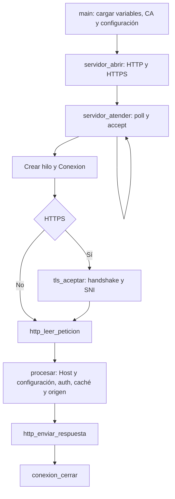

# Zonal Cache

## Recorrido de una petición

`servidor.c` escucha HTTP en `CACHE_PORT` y HTTPS en `CACHE_TLS_PORT`. Atiende cada conexión en su propio hilo para compartir la configuración y el índice del disco. Se atiende una sola petición por conexión.

`main.c` carga y valida la CA con `tls_iniciar`, descarga la configuración e inicia el polling. Después abre ambos sockets con `servidor_abrir` y llama a `servidor_atender`. Si falla la apertura HTTPS, cierra el socket HTTP y termina. El ciclo de atención usa `poll` sobre los dos listeners y crea un hilo por cliente; el handshake ocurre dentro de ese hilo.

Cada cliente se representa con una `Conexion`, que contiene el descriptor y un `SSL *` opcional. `http.c` usa `conexion_leer` y `conexion_escribir`: llaman a `recv` y `send` para HTTP, o a `SSL_read` y `SSL_write` para HTTPS. `conexion_cerrar` libera el objeto TLS cuando existe y cierra el socket al terminar la petición.



`http.c` lee la petición hasta el `\r\n\r\n` que cierra los headers y después el cuerpo según `Content-Length`. Si viene mal formada o sin `Host`, responde `400` y solo termina ese hilo.

Con la petición ya leída, HTTPS comprueba que `Host` corresponda al SNI, ignorando mayúsculas y el puerto del header. Si no coincide, responde `421 Misdirected Request`. Después `procesar` busca la regla vigente: sin regla responde `404`; si la conexión es TLS y la regla fue deshabilitada, responde `403 Forbidden`. Estos rechazos ocurren antes de autenticación, caché y origen.

La regla obtenida se conserva hasta terminar la cadena de procesamiento. Una recarga posterior no cancela una petición que ya pasó esa validación.

| Paso | Qué hace | Si no pasa |
| --- | --- | --- |
| `config_buscar` | Busca la URL configurada para el header `Host` | `404` |
| `auth_verificar` | Valida la seguridad que pida esa URL | `401` o `302` al login |
| `cache_buscar` | Sirve desde disco si está y no expiró | Sigue al origen |
| `origen_traer` | Trae el recurso del origen | `502`, porque el que falló es el origen y no la caché |
| `cache_guardar` | Guarda la respuesta si es cacheable | — |

Por ahora `cache_buscar` y `cache_guardar` están vacías, así que todo se trae del origen sin guardarse.

## Autenticación con `x-api-key`

Para una URL con `auth = api_key`, `auth_verificar` lee el header `x-api-key` del cliente y le pregunta al REST API si es de esa URL:

```
POST /api/cache/api-keys/verify
x-api-key: <llave de componente de la cache>

{ "url_id": 7, "key": "<llave del cliente>" }   →   { "valid": true }
```

El Worker calcula el SHA-256 de `key` y lo busca en `api_keys` junto con el `url_id`, así una llave de otra URL no sirve. La llave nunca se guarda en claro

| Caso | Respuesta |
| --- | --- |
| Sin header o vacío | `401`, sin preguntar al REST API |
| El REST API responde `valid: false` | `401` |
| El REST API no responde, responde otro código o un JSON sin `valid` | `503`, no se deja pasar |
| `valid: true` | Sigue a la caché y al origen |

En los tres rechazos `servidor.c` no llama a `cache_buscar` ni a `origen_traer`, así que no se toca el disco ni el origen. `auth_iniciar` guarda `NODE_API_URL`, `NODE_API_KEY` y `UI_LOGIN_URL` al arrancar.

## Autenticación con usuario y contraseña

Para una URL con `auth = user_password`, la caché nunca ve el usuario ni la contraseña: eso lo pide el formulario de la UI. La caché solo maneja la **sesión**, que viaja en la cookie `zc_session` de su propio dominio. El recorrido completo está en `docs/diagramas/flujo-usuario-contrasena.png`.

1. **Sin cookie, o con una que el REST API ya no acepta** (vencida o cerrada con logout), se responde `302` al formulario:

   ```
   Location: <UI_LOGIN_URL>?url=<id de la URL>&callback=<esquema>://<Host>/__auth/callback?next=<ruta original>
   ```

   `callback` va codificado con `%XX`, y la ruta original dentro de él, dos veces. El esquema es `https` si la petición llegó por `CACHE_TLS_PORT`.
2. La UI pide el usuario y la contraseña, llama `POST /api/auth/login` y redirige al `callback` agregándole `&session=<sesión>`.
3. **`GET /__auth/callback?next=...&session=...`** le pregunta al REST API si la sesión es de esa URL:

   ```
   POST /api/cache/sessions/verify
   x-api-key: <llave de componente de la cache>

   { "url_id": 4, "session": "<sesión>" }   →   { "valid": true }
   ```

   Si es válida, responde `302` a `next` con `Set-Cookie: zc_session=<sesión>; Path=/; HttpOnly; SameSite=Lax`, más `; Secure` si llegó por HTTPS. Sin `Domain`, la cookie queda solo para ese host.
4. **Con cookie**, cada petición pregunta a la misma ruta. Si `valid` es `true`, sigue a la caché y al origen. La expiración la decide el REST API: una sesión vencida da `valid: false` y se vuelve al paso 1.

| Caso | Respuesta |
| --- | --- |
| Sin cookie, o con una que da `valid: false` | `302` al formulario |
| La cookie da `valid: true` | Sigue a la caché y al origen |
| Callback sin `session` o con caracteres fuera de `[A-Za-z0-9]` | `400`, sin preguntar al REST API |
| Callback con una sesión que da `valid: false` | `401`, sin cookie |
| El REST API no responde o no devuelve `valid` | `503`, no se deja pasar |

`next` solo se acepta si es una ruta de ese mismo host (empieza con `/`, no con `//` ni `/\`, sin caracteres de control); si no, se vuelve a `/`. Así el callback no sirve para mandar a alguien a otro sitio.

### Prueba con `curl`

Worker con `wrangler dev` contra Supabase, caché en Docker con `NODE_API_KEY=dev-cache-key` y `UI_LOGIN_URL=http://localhost:5173/login`. Se usa `privado.externo-https.test` (URL `8`, `alonso` / `https-1234` del seed):

```bash
H=privado.externo-https.test
curl -si -H "Host: $H" "http://localhost:8080/get"                     # 302 al formulario con url=8 y callback
SES=$(curl -s -X POST http://localhost:8787/api/auth/login -H 'x-api-key: dev-ui-key' \
  -H 'content-type: application/json' -d '{"url_id":8,"username":"alonso","password":"https-1234"}' | jq -r .session)
curl -si -H "Host: $H" "http://localhost:8080/__auth/callback?next=%2Fget&session=$SES"   # 302 a /get con Set-Cookie
curl -si -H "Host: $H" -b "zc_session=$SES" "http://localhost:8080/get"                    # 200 desde httpbin
```

También se comprobó: contraseña mala da `401` en el login, una sesión inventada da `401` en el callback, una sesión de otra URL y la misma cookie después de `POST /api/auth/logout` dan `302`, por HTTPS la cookie lleva `Secure`, y con `SESSION_TTL_SECONDS=5` la cookie da `200` y a los 7 segundos `302`.

## Reenvío al origen

`origen_traer` le pide al origen de la URL lo mismo que pidió el cliente, con libcurl.

- **Dirección:** el `origin` de la URL más la ruta del cliente con su query. Si el origen es `http://java-api:8080` y el cliente pide `/items?pagina=2`, se pide `http://java-api:8080/items?pagina=2`.
- **Método y cuerpo:** se reenvían iguales, incluido `HEAD`, que en libcurl va con `CURLOPT_NOBODY` para que no espere un cuerpo.
- **Headers:** pasan todos los del cliente menos los que valen solo para una conexión (`Connection`, `Keep-Alive`, `Transfer-Encoding`, `TE`, `Trailer`, `Upgrade`), `Content-Length` (libcurl lo calcula), `Expect` y `Accept-Encoding`. Sin `Accept-Encoding` el origen responde sin comprimir y la caché no tiene que guardar una versión por cada codificación.
- **`Host`:** va el del origen y no el del cliente, porque es el nombre del sitio que el origen espera. Un origen como `https://httpbin.org` responde `404` si le llega otro nombre.
- **Respuesta:** el código, los headers sin los de conexión y el cuerpo ya sin el chunked. La caché le pone su propio `Content-Length` y `Connection: close`.
- **Redirects:** no se siguen. Un `302` del origen le llega al cliente tal cual.
- **HTTPS:** libcurl valida el certificado del origen contra las CA de `ca-certificates`.
- **Errores:** sin conexión, sin DNS o después de 30 segundos, `origen_traer` devuelve `-1` y la caché responde `502`.
- **Protocolos:** solo `http` y `https`. El origen lo escribe el dueño del dominio en la UI, y sin ese límite un origen `file:///etc` podría leer archivos del pod.

El cuerpo se arma completo en memoria, con un tope de 8 MB. Un recurso más grande da `502` hasta que haga falta mandarlo por pedazos.

## Caché en disco

Cada recurso guardado es un archivo `CACHE_DIR/<id de la URL>/<número>`, así cada URL tiene su carpeta y su tamaño se suma aparte. En memoria hay un índice protegido con un mutex, con la URL, la clave, los headers, el tamaño y el número de archivo de cada recurso.

- **Clave:** el host en minúsculas y sin el puerto, más la ruta con su query. Lleva el host porque una URL con wildcard atiende varios, y `img.marca.com/logo.png` no es lo mismo que `www.marca.com/logo.png`.
- **Qué se guarda:** solo un `GET` con `200` cuyo tipo esté en los `file_types` de su URL. El tipo es la extensión de la ruta o, si la ruta no tiene, el `Content-Type`, así `application/json` cuenta como `json`. Cuatro subtipos se traducen porque no se escriben igual que su extensión: `javascript` es `js`, `jpeg` es `jpg`, `svg+xml` es `svg` y `plain` es `txt`.
- **Qué no se guarda:** nada con `Set-Cookie`, porque es de un usuario en particular, ni con `Cache-Control: private` o `no-store`.
- **Límite:** un recurso más grande que `cache_size_bytes` se sirve sin guardar y sin sacar a nadie, porque nunca cabría. Si no, antes de guardar se sacan todas las entradas vencidas y la versión vieja del mismo recurso, y mientras lo que ocupa la URL más el recurso nuevo pase del límite se saca una víctima de esa misma URL con su `replacement_policy`. Las otras URLs no se tocan, cada una tiene su límite.
- **Reemplazo:** cada entrada lleva su orden de llegada, su último uso y cuántas veces se usó. El último uso es un contador que sube con cada hit, no la hora, para que dos usos del mismo segundo no empaten. FIFO saca la que llegó primero, LRU la de uso más viejo, MRU la de uso más reciente, LFU la menos usada y, si empatan, la de uso más viejo, y Random una cualquiera de esa URL con `rand()`, sembrado una sola vez al arrancar. Una política desconocida se trata como LRU.
- **Escritura:** el cuerpo se escribe sin el mutex en un temporal de `mkstemp`, y con el mutex se renombra al nombre final. `rename` cambia el archivo de una sola vez, así nadie lee uno escrito a medias.
- **Hit:** con el mutex solo se copian los headers y la ruta del archivo, y el archivo se lee después. Si otro hilo lo reemplaza o lo borra en ese momento, el archivo que ya estaba abierto se sigue leyendo bien. La respuesta lleva `X-Cache: HIT`.
- **TTL:** cada entrada guarda el segundo en que vence, que es cuando se guardó más el `ttl_seconds` de su tipo. Se mide con `CLOCK_MONOTONIC`, que no retrocede si cambia la hora del sistema. Una entrada vencida no se sirve: `cache_buscar` la borra del índice y del disco y responde como miss, así se vuelve a pedir al origen.
- **Purga:** un hilo duerme `PURGE_INTERVAL_SECONDS` y saca todas las entradas vencidas, también las que nadie vuelve a pedir y que si no se quedarían ocupando espacio. Duerme sin el mutex, así no frena a los clientes. Las pruebas adelantan el reloj con `cache_adelantar_reloj` en vez de esperar.
- **Al arrancar:** en Kubernetes `CACHE_DIR` es un `emptyDir`, así que la caché empieza vacía. Si en una corrida local quedan archivos de antes, no se borran ni cuentan para el límite.

## Configuración

Al arrancar, la caché lee estas variables de entorno y no arranca si falta alguna o no sirve.

| Variable | Qué es |
| --- | --- |
| `CACHE_PORT` | Puerto HTTP, de 1 a 65535 |
| `NODE_API_URL` | Dirección base del REST API Node.js, con `http://` o `https://` |
| `NODE_API_KEY` | Llave de componente, que viaja en el header `x-api-key` |
| `UI_LOGIN_URL` | Formulario `/login` de la UI, con `http://` o `https://`; destino del `302` de las URLs con `user_password` |
| `CONFIG_REFRESH_SECONDS` | Cada cuántos segundos se vuelve a pedir la configuración |
| `PURGE_INTERVAL_SECONDS` | Cada cuántos segundos se borran las entradas vencidas |
| `CACHE_TLS_PORT` | Puerto HTTPS, de 1 a 65535 y distinto de `CACHE_PORT` |
| `TLS_CA_CERT_FILE` | Ruta al certificado público `rootCA.pem` |
| `TLS_CA_KEY_FILE` | Ruta a la llave privada `rootCA-key.pem` |

Antes de descargar la configuración o abrir sockets, se leen los archivos PEM de la CA y se comprueba su vigencia, su capacidad de firma y que la llave privada corresponda al certificado. Si falla esa validación, el proceso termina. `.env.example` incluye valores de ejemplo para todas estas variables.

Después pide `GET /api/cache/config` y la vuelve a pedir cada `CONFIG_REFRESH_SECONDS` desde un hilo aparte. Si el API no responde, contesta algo distinto de `200` o manda un JSON que no sirve, se mantiene la configuración que había. Si eso pasa al arrancar, HTTP responde `404` y HTTPS rechaza la negociación hasta recibir reglas en una recarga. Una URL a la que le falta un campo del contrato se ignora sin tumbar las demás.

### Estructura de las URLs

La respuesta de `GET /api/cache/config` contiene una lista `urls`. El contrato incluye `tls_enabled` para indicar si el host acepta HTTPS del cliente:

```json
{
  "urls": [
    {
      "id": 7,
      "pattern": "api.marca.com",
      "tls_enabled": true,
      "origin": "http://java-api:8080",
      "cache_size_bytes": 1048576,
      "replacement_policy": "lru",
      "auth": "api_key",
      "file_types": [
        { "extension": "json", "ttl_seconds": 30 }
      ]
    }
  ]
}
```

`origin` indica el protocolo y la dirección del origen, independientemente de `tls_enabled`.

Actualmente `config.h` representa cada elemento con estas estructuras:

```c
typedef struct {
    char *extension;
    int ttl_segundos;
} TipoArchivo;

typedef struct Configuracion Configuracion;

typedef struct {
    int id;
    char *patron;
    bool tls_enabled;
    char *origen;
    size_t tamano_maximo;
    char *politica;
    char *auth;
    TipoArchivo *tipos;
    size_t num_tipos;
    Configuracion *dueno;
} UrlConfig;
```

`tls_enabled` es obligatorio y debe ser un booleano JSON (`true` o `false`). `dueno` apunta a la configuración que contiene la regla y permite mantenerla viva durante una petición.

En la UI, el formulario puede usar `^https://` sobre la dirección ingresada para rellenar inicialmente la opción de TLS. La persona puede cambiarla antes de guardar.

### Cómo se escoge la URL

`config_buscar` compara el `Host` sin el puerto y sin importar mayúsculas.

| Patrón | Calza con | No calza con |
| --- | --- | --- |
| `www.marca.com` | `www.marca.com`, `WWW.marca.com:8080` | `img.marca.com` |
| `*.marca.com` | `marca.com`, `www.marca.com`, `a.b.marca.com` | `otramarca.com`, `marca.com.otro.com` |

La exacta le gana a la wildcard y entre wildcards gana la más específica. El `*` cubre el dominio raíz y subdominios de cualquier profundidad: `v1.api.marca.com` calza con `*.marca.com` y `*.api.marca.com`, y se escoge esta última. Es la misma regla que usa la resolución del Interceptor.

### Recarga sin cortar peticiones

Una petición usa su `UrlConfig` desde `config_buscar` hasta que termina, y en ese tiempo puede llegar una recarga. Para que la configuración vieja no se libere mientras alguien la usa, cada configuración lleva un contador de usos protegido con un mutex.

- La configuración vigente cuenta como un uso.
- `config_buscar` suma uno y `config_soltar` resta uno. El servidor suelta la regla al terminar la petición; la selección por SNI la suelta después de copiar el patrón, antes de generar un certificado.
- `config_instalar` cambia el puntero a la nueva y le quita a la vieja el uso de ser la vigente.
- Quien deja el contador en 0 libera la configuración. Si nadie la estaba usando, es la recarga. Si no, es la última petición que la tenía.

Toda búsqueda debe emparejarse con `config_soltar`. La tabla TLS no guarda `UrlConfig *`. `config_patron_tls_habilitado` consulta si un patrón exacto, incluido `*.` cuando corresponda, sigue habilitado. Devuelve un booleano y suelta el mutex de configuración antes de regresar.

## TLS termination

`tls.c` y `tls.h` cargan la CA, emiten certificados en memoria y seleccionan contextos por SNI. El servidor ya atiende ambos listeners y usa el procesamiento HTTP existente después del handshake. Queda pendiente integrar la configuración real del API, la UI y el despliegue con el Secret de la CA y la exposición de los puertos públicos.

| Función | Responsabilidad |
| --- | --- |
| `tls_iniciar` | Cargar la CA y la llave; preparar el contexto inicial y el callback SNI antes de crear hilos |
| `tls_crear` | Crear un `SSL` asociado al descriptor; el llamador todavía debe ejecutar el handshake |
| `tls_aceptar` | Crear la sesión y completar el handshake con un plazo total de 10 segundos |
| `tls_ensure_cert` | Obtener o emitir el contexto del patrón para el tiempo indicado, con una referencia propia para el llamador |
| `tls_liberar` | Liberar la CA, los contextos y la tabla cuando ya no haya conexiones TLS en uso |

HTTP permanece disponible sin redirección automática, incluso para reglas que permiten HTTPS. El despliegue expondrá 80 y 443 hacia los puertos internos correspondientes.

Si falla el ciclo de atención, `main.c` cierra ambos listeners y termina el proceso. En esa salida no libera la CA ni la tabla manualmente porque puede haber hilos de clientes usándolas. `tls_liberar` se usa cuando todavía no se aceptaron clientes o cuando ya no quedan sesiones en uso.

La caché termina la sesión TLS del cliente para poder leer la petición, validar su seguridad y consultar el disco. Después del descifrado se usa la misma cadena de procesamiento que para HTTP. Si hace falta consultar un origen HTTPS, libcurl abre otra sesión TLS y valida el certificado del origen como hasta ahora.

### Transporte implementado

Cada `Conexion` es dueña de su `SSL *`; en HTTP el puntero es `NULL`. La lectura TLS devuelve los datos recibidos, `0` ante un cierre con `close_notify` y `-1` ante un error, incluido un cierre TCP sin aviso TLS. Los errores TLS no se traducen a `errno`: el código HTTP solo necesita el valor devuelto. Las escrituras devuelven la cantidad enviada y el código HTTP existente completa las escrituras parciales. Cada llamada limita el tamaño a `INT_MAX`, que es el máximo admitido por estas funciones de OpenSSL.

Después del handshake, el transporte usa sockets bloqueantes con timeouts de lectura y escritura de 10 segundos. Si OpenSSL devuelve `WANT_READ` o `WANT_WRITE`, la operación falla sin reiniciar la espera. Después de un error TLS solo se permite cerrar la conexión.

`tls_aceptar` pone temporalmente el socket en modo no bloqueante y fija un vencimiento con `CLOCK_MONOTONIC`. Cada intento de `SSL_accept` y cada espera con `poll` usan el tiempo restante. Recibir fragmentos o una interrupción por señal no reinicia el plazo. Al terminar se restaura el modo original del socket. Un fallo o vencimiento cierra la conexión desde el hilo del cliente sin intentar responder HTTP.

Al cerrar una sesión establecida, se intenta enviar `close_notify` con el socket en modo no bloqueante, sin esperar respuesta. Después se libera `SSL` y se cierra el descriptor. Repetir el cierre no vuelve a liberar recursos. `main.c` ignora `SIGPIPE` antes de crear hilos para que un cliente desconectado no termine el proceso durante una escritura de OpenSSL.

Las pruebas de transporte crean un certificado temporal en memoria, verifican su confianza y nombre en el cliente y pasan peticiones y respuestas por las funciones HTTP actuales. También cubren escrituras parciales, timeouts, desconexiones y cierre. El Dockerfile instala `libssl-dev` en el compilador y `libssl3` en la imagen final; `make test` ejecuta la suite con `-Wall -Wextra -Werror`. El manejo de errores y cierre sigue las interfaces de [SSL_get_error](https://docs.openssl.org/3.0/man3/SSL_get_error/) y [SSL_shutdown](https://docs.openssl.org/3.0/man3/SSL_shutdown/).

### CA local

Todas las cachés zonales usan la misma CA local para firmar sus certificados de servidor. Sus rutas se reciben en `TLS_CA_CERT_FILE` y `TLS_CA_KEY_FILE`. El montaje de `rootCA.pem` y `rootCA-key.pem` desde un Secret de Kubernetes queda pendiente de integrar al despliegue.

La CA se carga una vez; cambiar sus archivos requiere reiniciar el proceso. La emisión también comprueba que siga vigente. Los contextos permiten TLS 1.2 y TLS 1.3. No anuncian HTTP/2, no reutilizan sesiones TLS y no aceptan renegociación: cada nueva sesión pasa por la selección SNI con la configuración vigente.

A la hora de hacer pruebas el cliente confía en `rootCA.pem`, con `curl --cacert` o instalándolo como autoridad de confianza en el navegador. El certificado del servidor incluye el patrón configurado en `Subject Alternative Name` (SAN), ya sea un nombre exacto o una wildcard.

`scripts/generar-ca.sh` usa OpenSSL para crear la CA local en `.certs/` (`rootCA.pem` y `rootCA-key.pem`) y reutilizarla si ambos archivos ya existen. No instala la CA en los almacenes de confianza del cliente. Si solo existe uno de los dos archivos, el script falla sin sobrescribirlo. Se ejecuta desde la raíz con `sh scripts/generar-ca.sh`. La emisión dentro de la caché usa las funciones de OpenSSL, sin ejecutar comandos externos.

### Certificados en memoria

Cada proceso mantiene una tabla compartida por sus hilos, como una lista de entradas por patrón normalizado. Cada entrada guarda una copia del patrón y un `SSL_CTX *`, que mantiene el certificado y la llave privada del servidor cargados en OpenSSL. Un mutex protege la búsqueda, la emisión y la publicación de contextos.

La clave es el `pattern` de la regla seleccionada. Un certificado para `*.marca.com` se reutiliza para `www.marca.com` y `api.marca.com`. Un wildcard TLS solo cubre un nivel de subdominio: para el raíz (`marca.com`) o un host más profundo (`a.b.marca.com`), se emite y reutiliza un certificado exacto para ese host. La tabla copia el nombre y no conserva punteros a `UrlConfig`.

`tls_ensure_cert(patron, ahora)` exige que el patrón o la regla seleccionada para el host siga habilitado para TLS. Si no hay un contexto reutilizable, genera una llave RSA de 2048 bits y un certificado firmado con SHA-256. El certificado tiene SAN igual al patrón, `CA:FALSE`, uso de firma digital e intercambio de llaves y autenticación de servidor. Incluye los identificadores de llave del sujeto y de la autoridad (`Subject Key Identifier` y `Authority Key Identifier`) según las [extensiones de OpenSSL](https://docs.openssl.org/3.0/man5/x509v3_config/). Su vigencia es de 30 días como máximo, limitada por el vencimiento de la CA. Se renueva cuando falta un día o menos. El tiempo se recibe como argumento para probar la renovación sin esperas.

La tabla posee una referencia a cada contexto. Quien obtiene uno recibe otra referencia y la libera con `SSL_CTX_free`. Al seleccionarlo con `SSL_set_SSL_CTX`, OpenSSL conserva la referencia que necesita la conexión. Renovar o retirar una entrada libera solo la referencia de la tabla.

Antes de crear o renovar se recorre la tabla y se retiran las entradas cuyos patrones ya no estén habilitados. La limpieza comprueba patrones con `config_patron_tls_habilitado` y hosts con `config_buscar`, sin copiar listas. Durante esa operación el mutex TLS puede tomar el de configuración; `config.c` no llama a TLS y nunca toma sus candados en el orden contrario. La emisión criptográfica ocurre con el mutex de configuración libre.

Una entrada puede permanecer hasta la siguiente emisión, pero no autoriza nuevas sesiones: el callback siempre consulta la regla vigente. Si falla la emisión, se liberan los objetos parciales y no se publica el contexto.

Los certificados y sus llaves se generan bajo demanda y permanecen en memoria. No se guardan en Supabase ni en un volumen. Cada caché puede emitir certificados distintos porque todos están firmados por la misma CA.

### Selección por SNI implementada

El contexto inicial no contiene un certificado genérico. El callback de [SNI de OpenSSL](https://docs.openssl.org/3.0/man3/SSL_CTX_set_tlsext_servername_callback/) exige un nombre DNS, lo normaliza a minúsculas y busca su regla con `config_buscar`. Rechaza nombres ausentes, direcciones IP, wildcards enviadas como nombre y etiquetas inválidas. Sin regla o con TLS deshabilitado, la negociación falla. Una exacta deshabilitada sigue ganando a una wildcard habilitada.

La selección y emisión se prueban con una CA temporal y sockets locales, verificando confianza, nombre y validación X.509 estricta del certificado. También se cubren versiones TLS, reglas retiradas, certificados wildcard, emisión concurrente y renovación con referencias abiertas.

### Flujo HTTPS

1. El cliente abre TCP y envía el `ClientHello` con el nombre del host en SNI. En este punto todavía no se ha recibido HTTP.
2. La caché busca el SNI en la configuración vigente con las mismas reglas exactas y wildcard de `config_buscar`. Sin SNI, sin una regla o con `tls_enabled: false`, se rechaza el handshake.
3. Con una regla habilitada, llama a `tls_ensure_cert` con el patrón de la regla seleccionada. Si el certificado no cubre el SNI (raíz o subdominio profundo bajo wildcard), obtiene un certificado exacto para ese host y lo presenta. Si falla la generación o la carga del contexto, termina el handshake sin pasar a HTTP. La referencia a la configuración usada para esta validación se suelta al terminar de usarla.
4. Después de completar TLS, el transporte ya implementado en `Conexion` usa `SSL_read` y `SSL_write`. El parseo HTTP y el procesamiento se comparten con el servidor sin TLS.
5. El `Host` HTTP debe corresponder al SNI, ignorando mayúsculas y el puerto del header. Si no coincide, se responde `421`. Antes de procesar se vuelve a comprobar la regla vigente y `tls_enabled`; si el host fue eliminado o deshabilitado durante el handshake, no se atiende la petición.
6. Se ejecuta la cadena habitual y se cierra la conexión después de responder. Un fallo de negociación TLS no recibe un error HTTP porque todavía no existe un canal HTTP establecido.

Una entrada en la tabla de certificados no autoriza a atender un host: esa decisión siempre depende de la configuración vigente. Al retirar entradas o renovar contextos se respetan las referencias de las conexiones que aún los usan.

## Código tomado del P1

Viene del Health Checker del P1 (`src/health-checker/`), escrito por este mismo grupo.

| En el P2 | En el P1 | Cambios |
| --- | --- | --- |
| `log.c`, `log.h` | `src/log.c`, `include/log.h` | Ninguno |
| `tests/fake_server.c`, `tests/fake_server.h` | `tests/fake_server.c`, `tests/fake_server.h` | Puede responder con un cuerpo en `response_body` |
| `read_required`, `read_int` y `validate_positive` en `config.c` | `src/config.c` | Ninguno |
| `http_acumular` en `http.c` | `append_response` en `src/api_client.c` | El tope va en el `Buffer`, así lo usan `config.c` (1 MB) y `origen.c` (8 MB) |
| `pedir_config` en `config.c` | `perform_request` en `src/api_client.c` | Solo `GET`, con la llave en `x-api-key` y sin la CA propia, porque el Worker tiene un certificado real |
| `Dockerfile` | `Dockerfile` | Misma estructura multietapa sobre `debian:bookworm-slim` con usuario sin privilegios |
| `Makefile` | `Makefile` | Simplificado a dos objetivos, `zonal-cache` y `test`; enlaza OpenSSL para el transporte TLS |
