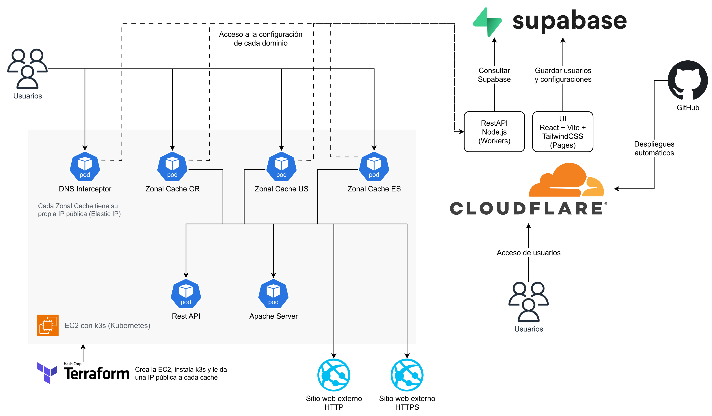

# Documentación final: Proyecto 2, Proxy/Caché con Geolocalización

Curso Redes (IC-7602), Instituto Tecnológico de Costa Rica, II Semestre 2026.

Cada sección resume y enlaza a la guía donde está el detalle.

## Integrantes

| Carné | Nombre completo |
| --- | --- |
| 2024080534 | José Fabián Zumbado Ruiz |
| 2023044780 | Alonso Durán Muñoz |
| 2023047710 | Santiago Chaves Garbanzo |
| 2024145458 | Allan David Bolaños Barrientos |
| 2023057623 | Ana Isabel Hernández Muñoz |

## 1. Arquitectura general

El sistema tiene cuatro piezas principales: un **DNS Interceptor** (GNU C) que recibe las consultas DNS
y responde la IP de la caché zonal más cercana al país del cliente, varias **Zonal Cache** (GNU C) que
validan la seguridad de cada URL y sirven el recurso desde disco o desde el origen, un **REST API
Node.js** (Hono sobre Cloudflare Workers) que consultan el Interceptor y las cachés, y una **UI**
(React en Cloudflare Pages) con la que cada persona administra sus dominios y URLs. Detrás de las
cachés hay cuatro orígenes de prueba: un REST API en Java, un Apache, un sitio externo HTTP y uno HTTPS.



Decisiones clave:

- Se usa Supabase en lugar de Firebase y Cloudflare en lugar de Vercel, con autorización del profesor
  en la clase del 06/10.
- Ningún componente de Kubernetes habla con Supabase directamente: el Interceptor y las cachés
  preguntan todo al REST API Node.js, así ninguna llave de Supabase vive dentro del clúster.
- La UI sí usa Supabase para su CRUD, protegida con Row Level Security, y solo llama al REST API para
  lo que necesita privilegios (verificar el registro TXT y el login de las URLs).
- El REST API Node.js se autentica con API Keys de componente, cada una con su alcance (`ui`,
  `interceptor`, `cache`). Son distintas de las `x-api-key` que cada persona crea en la UI para
  proteger sus URLs.
- Una sola imagen de caché sirve a todas las zonas; cada instancia recibe su `CACHE_ZONE` y su propia
  Elastic IP.
- Kubernetes corre en una EC2 de AWS con k3s, creada e instalada con Terraform y desplegada con un
  Helm Chart propio.
- En usuario y contraseña, la sesión la devuelve la UI en el `callback` y es la caché la que la
  convierte en cookie de su propio dominio.

Documentos de arquitectura por componente:

1. [Resumen, recorrido de una petición y contratos](../README.md#5-arquitectura)
2. [DNS Interceptor](03-arquitectura/dns-interceptor.md)
3. [Zonal Cache](03-arquitectura/zonal-cache.md)
4. [REST API Node.js](03-arquitectura/node-api.md)
5. [UI](03-arquitectura/ui.md)
6. [Supabase](03-arquitectura/supabase.md)
7. [Orígenes: REST API Java y Apache](03-arquitectura/origenes.md)
8. [Helm Chart](03-arquitectura/helm.md)
9. [Infraestructura con Terraform](03-arquitectura/infraestructura.md)

## 2. Instalación

Requisitos: Git, Docker, Terraform, AWS CLI, kubectl, Helm y [just](https://github.com/casey/just), una
cuenta de Supabase (plan gratuito) y una cuenta de AWS. No hace falta gcc, Java, pandoc ni LaTeX: todo
se compila dentro de contenedores. En Windows, las recetas de `just` se corren desde Git Bash.

### 2.1 Clonar y configurar

```bash
git clone https://github.com/JoseZum/2026-02-2024080534-IC7602-P2.git
cd 2026-02-2024080534-IC7602-P2
cp .env.example .env
```

Completar `.env` con la conexión a Supabase (`SUPABASE_DB_URL`), la URL del REST API Node.js
(`NODE_API_URL`), las llaves de componente (`LLAVE_INTERCEPTOR`, `LLAVE_CACHE`), el formulario de
login de la UI (`UI_LOGIN_URL`) y las IP públicas del equipo (`TF_VAR_ips_equipo`). El archivo no se
versiona. La tabla completa de variables y las credenciales de AWS (cuenta normal o AWS Academy) están
en la [guía de instalación](01-instalacion/README.md).

### 2.2 Base de datos en Supabase

```bash
just db
just db-test
```

`just db` aplica el esquema, los datos de prueba y la tabla IP-to-Country, y se puede repetir sin
duplicar nada. `just db-test` corre las pruebas de RLS.

### 2.3 REST API Node.js y UI en Cloudflare

Se despliegan solos con cada merge a `main`: el REST API en `https://zonal-api.duran-munozalonso.workers.dev`
y la UI en `https://zonal-ui.pages.dev`. Para montarlos en otra cuenta de Cloudflare, ver
[despliegue del REST API Node.js](01-instalacion/node-api.md).

### 2.4 Infraestructura y componentes en AWS

```bash
just infra
just up
```

`just infra` crea con Terraform la VPC, la EC2 con k3s, una Elastic IP por zona y los repositorios de
ECR. `just up` construye las imágenes (cada una corre sus pruebas al construirse), las publica en ECR e
instala el Helm Chart. No hace falta entrar a la consola de AWS ni conectarse por SSH.

### 2.5 Probar y apagar

```bash
nslookup java-api.test <ip-del-interceptor>
curl -i --resolve java-api.test:80:<ip-de-la-cache> http://java-api.test/api/productos
just infra-down
```

La EC2 y las Elastic IP cobran mientras existen, por eso se apaga con `just infra-down`. Guía completa,
con solución de problemas: [guía de instalación](01-instalacion/README.md).

## 3. Guía de uso

La [guía de uso](02-uso/README.md) explica, para una persona sin conocimientos del código:

1. Qué hace el sistema.
2. Crear una cuenta e iniciar sesión.
3. Registrar y verificar un dominio con un registro TXT.
4. Crear las URLs de un dominio, con wildcards, tamaño de caché, tipos de archivo, TTL y política de
   reemplazo.
5. Proteger una URL con API Key o con usuario y contraseña.
6. Qué ve quien visita una URL con usuario y contraseña.
7. Probar el sistema con `nslookup` y `curl`.
8. Problemas comunes.

## 4. Qué funciona y qué no

La [tabla de funcionalidades](07-funcionalidades/README.md) lista cada aspecto que pide el enunciado.
Los 27 aspectos funcionan:

| Componente | Aspectos | Funcionan |
| --- | ---: | ---: |
| DNS Interceptor | 3 | 3 |
| Zonal Cache | 9 | 9 |
| REST API Node.js | 3 | 3 |
| UI | 6 | 6 |
| REST API Java y Apache | 4 | 4 |
| Automatización | 2 | 2 |

## 5. Pruebas realizadas

Hay tres niveles: pruebas unitarias de cada componente, pruebas de despliegue sobre un Kubernetes real
(k3s dentro de Docker) y la prueba de punta a punta contra las IP públicas de AWS. Todas se corren con
`just`.

| Componente | Comando | Qué cubre |
| --- | --- | --- |
| DNS Interceptor (Criterion) | `just test` | Parseo del header y la question, `FORMERR`, `SERVFAIL` y armado del response `A` |
| Zonal Cache (Criterion) | `just test` | HTTP, configuración, disco, TTL, algoritmos de reemplazo, autenticación y concurrencia |
| REST API Java (JUnit) | `just test` | Verbos GET, POST, PUT y DELETE |
| REST API Node.js (vitest) | `just api-test` | Rutas, alcances de las llaves, login por URL y verificación TXT |
| Supabase | `just db-test` | Row Level Security |
| Orígenes | `just test-origenes` | Imágenes del REST API Java y del Apache |
| Terraform | `just test-infra` | Plan con AWS simulado |
| Helm | `just test-helm` y `just test-k3s` | Plantillas del chart e instalación en k3s |
| UI (vitest) | `npm test` en `src/ui` | Validaciones, llaves, formato y validación del callback |
| Punta a punta | `just integracion` | Todo el recorrido contra AWS ([detalle](05-pruebas/punta-a-punta.md)) |

El resumen con las cantidades y resultados de la última corrida está en [pruebas](05-pruebas/README.md).

## 6. Conclusiones

1. Se usó un hilo por conexión porque el índice de la caché tiene que ser uno solo y compartido; con procesos distintos cada uno tendría el suyo. El mutex protege solo el índice y `helgrind` no reporta carreras en `cache.c`.
2. Para guardar un recurso se escribe en un archivo temporal y se renombra, así nadie lee un archivo a medias. Un archivo ya abierto se sigue leyendo aunque otro hilo lo borre.
3. El límite de tamaño se garantiza antes de guardar: se sacan primero los vencidos y luego víctimas de esa URL según su política. En la prueba de punta a punta, 300 PNG dejaron `externo-http.test` en 2 095 562 de 2 097 152 bytes.
4. LRU y MRU usan un contador de usos y no la hora, porque dos accesos en el mismo segundo empatarían. LFU sí puede empatar y se desempata con LRU.
5. El TTL necesita un hilo que purgue, porque lo vencido que nadie vuelve a pedir seguiría ocupando espacio. El vencimiento se mide con `CLOCK_MONOTONIC` para que un cambio de hora no lo afecte.
6. Solo se cachea un `GET` con `200` de un tipo configurado, y nada con `Set-Cookie`, `private` o `no-store`. Si la ruta no tiene extensión se usa el `Content-Type`, y así el REST API Java también se cachea.
7. El Interceptor da la misma IP de caché a todos los dominios de una zona, así que la caché distingue el sitio por el header `Host`. Por eso la clave de caché lleva el host y al origen se le manda su propio `Host`.
8. El origen lo escribe el usuario en la UI, así que no es de confianza. libcurl solo acepta `http` y `https` (con un origen `file:///` se leerían archivos del pod), no sigue redirects y no recibe `Accept-Encoding`.
9. La UI hace su CRUD directo en Supabase protegida por RLS, y la caché y el Interceptor solo hablan con el REST API con una llave de componente con alcance. La llave de la UI se ve en el navegador, por eso su alcance es mínimo.
10. En usuario y contraseña la caché nunca ve la contraseña: la UI valida contra la base, devuelve la sesión en el `callback` y la caché la verifica y la deja en una cookie `HttpOnly` de su propio dominio. La UI no comprueba que el host del `callback` pertenezca a la URL; la sesión solo vale para esa URL y expira.
11. La caché descarta las URLs sin `tls_enabled` y el Worker no lo mandaba, así que cargaba 0 URLs y respondía `404` a todo. Las pruebas con un API falso no lo vieron; salió al conectar con la ruta real.
12. Para SSL termination la caché emite en memoria un certificado por host según el SNI, firmado por una CA local, y por eso `curl --cacert` funciona sin `-k`. Un wildcard cubre un solo nivel, así que el dominio raíz necesita su certificado exacto.
13. Una Elastic IP por zona en una sola EC2 se logra con IP privadas secundarias y `externalIPs` en cada `Service`, y con `externalTrafficPolicy: Local` para que el Interceptor vea la IP del cliente y no la del nodo.
14. Terraform, Helm y `just` dejan la instalación en `just infra` y `just up`. Probar el chart y la prueba de punta a punta en un k3s dentro de Docker permitió validar casi todo sin gastar créditos de AWS, y al correrla en AWS pasó completa.
15. Los hitos de integración del 11/10, 15/10 y 22/10 no se cumplieron y casi todo se juntó en las últimas semanas. El reenvío al origen estuvo semanas probado solo contra un servidor eco.

## 7. Recomendaciones

1. Correr la caché contra la ruta real `GET /api/cache/config` desde la primera semana y no contra un API falso. Así lo de `tls_enabled` se habría visto en días.
2. Tener los orígenes reales (API Java y Apache) antes de cerrar el reenvío al origen, para no probarlo contra servidores sustitutos.
3. Fijar un hito de integración cada semana con revisión entre pares, como recomienda el enunciado, en lugar de dejarla para el final.
4. Correr las pruebas de Criterion y la de punta a punta en k3s en cada PR. Hoy son comandos manuales, y tras integrar la caché en disco dos pruebas dejaron de compilar sin que nadie lo notara.
5. Probar la geolocalización con clientes reales de otros países, por ejemplo con una VPN. En AWS se probó con la IP real de Costa Rica; US, ES y GB solo con `client_ip` simulado.
6. Soportar EDNS Client Subnet en el Interceptor. Hoy geolocaliza la IP de quien le pregunta, que suele ser el resolver y no la persona.
7. Pasar los cuerpos grandes al disco por pedazos en vez de armarlos completos en memoria. Hoy un recurso de más de 8 MB da `502`.
8. Atender varias peticiones por conexión y usar un pool de hilos en vez de un hilo por conexión si la carga sube.
9. Guardar el disco de la caché en un volumen persistente y reconstruir el índice al arrancar. Con `emptyDir` cada reinicio empieza vacío.
10. Agregar a la UI un campo para activar HTTPS en cada URL. Hoy `tls_enabled` solo se cambia en Supabase.
11. Hacer que `POST /api/auth/login` compare el host del `callback` con el patrón de la URL antes de devolver la sesión.
12. Usar certificados de una CA pública en lugar de la CA local, para que ningún cliente tenga que instalar `rootCA.pem` o usar `-k`.
13. Mover las llaves a un gestor de secretos y no cargar `seed.sql` fuera de desarrollo, porque sus llaves y contraseñas (`dev-*`) son públicas.
14. Para más de 4 zonas, repartir las cachés en varias regiones o usar un balanceador. AWS da 5 Elastic IP por región y una es del Interceptor.
15. Actualizar la documentación en el mismo PR que cambia el comportamiento. Varias guías siguieron diciendo que `cache_buscar` estaba vacía mucho después de implementarla.

## 8. Declaración de uso de IA

Ver la sección 7 del [README](../README.md#7-uso-de-ia).
