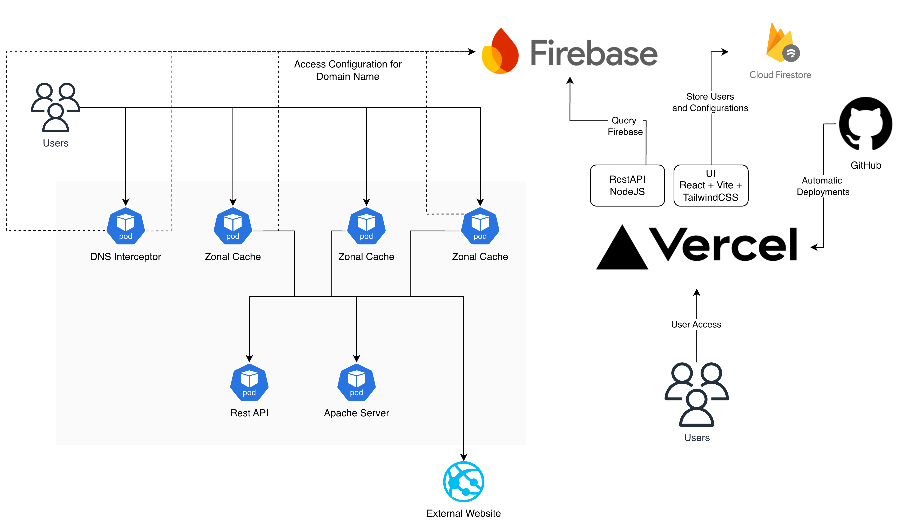

# Proyecto 2

**Tecnológico de Costa Rica**  
**Escuela de Ingeniería en Computación**  
**Redes(IC 7602)**  
**Segundo Semestre 2026**

---

## 1. **Objetivo General**

- Implementar un proxy/cache de aplicación con geolocalización.

---

## 2. **Objetivos Específicos**

- Desarrollar servidores UDP y TCP en GNU C.

- Implementar el procesamiento de algunas peticiones DNS especificadas en el RFC 2929.

- Desarrollar servicios de caché junto con algoritmos de reemplazo.

- Diseñar servicios de autenticación para APIs y sitios web.

- Diseñar e implementar una aplicación web utilizando inteligencia artificial generativa.

- Implementar una API REST en Java.

- Automatizar una solución mediante el uso de Docker, Helm Charts, HashiCorp Terraform, Docker Compose, Kubernetes o proveedores de nube (Cloud Providers).

---

## 3. **Datos Generales**

➜ El valor del proyecto: 30%

➔ El proyecto debe ser implementada en grupos de máximo 5 personas.

➔ Cualquier indicio de copia será calificado con una nota de 0 y será procesado de acuerdo con el reglamento. La copia incluye código/configuraciones que se puede encontrar en Internet y que sea utilizado parcial o totalmente sin el debido reconocimiento al autor.

➔ La revisión se realiza de forma presencial mediante una evaluación escrita, para cuya resolución deben estar presentes todos los integrantes del grupo.

➔ Se debe incluir documentación con instrucciones claras para ejecutar el proyecto.

➔ Se espera que todos y todas las integrantes del grupo entiendan la implementación suministrada.

➔ Se deben seguir buenas prácticas de programación en el caso de que apliquen. Por ejemplo, documentación interna y externa, estándares de código, diagramas de arquitectura, diagramas de flujo, pruebas unitarias son algunas de las buenas prácticas que se esperan de un estudiante de Ingeniería en Computación.

➔ El lenguaje de implementación, en caso de ser requerido y no especificado por el profesor, deberá ser seleccionado por cada grupo y debe quedar debidamente documentado. No se permite el uso de Python.

➔ Toda documentación debe ser implementada en Markdown.

➔ Si la instalación de servicios no se encuentra automatizado se obtendrá una nota de 0. Si el proyecto no se entrega completo, la porción que sea entregada debe estar completamente automatizada, de lo contrario se obtendrá una nota de 0.

➔ En caso de no entregar documentación se obtendrá una nota de 0.

➔ El email de entrega debe contener una copia del proyecto en formato tar.gz y un link al repositorio dónde se encuentra almacenado, debe seguir los lineamientos en el documento `Lineamientos para el envío de emails.pdf`.

➔ Los grupos de trabajo deben autogestionarse; la persona facilitadora del curso no es responsable si un miembro del equipo no realiza su trabajo.

➔ En consultas presenciales, por correo electrónico o por Telegram, como mínimo se debe haber leído sobre el tema y haber intentado comprenderlo. Las consultas deben ser concretas y se debe demostrar que se intentó resolver el problema en cuestión.

➔ El uso de Inteligencia Artificial (IA) estará regulado por los lineamientos establecidos en el documento `Política para el Uso de Inteligencia Artificial Generativa.pdf`.

---

## 4. **Descripción**

El Proyecto II busca profundizar en los temas de la capa de aplicación y la capa de transporte mediante la implementación de aplicaciones que utilicen los protocolos TCP y UDP. Como parte de este ejercicio, se deberá implementar la siguiente arquitectura:

Se deberán crear los siguientes componentes:

### DNS Interceptor

Este componente debe ser tomado y adaptado del primer proyecto. Es una aplicación intermediaria entre el cliente y el servidor DNS. Su funcionamiento consiste en interceptar peticiones dirigidas hacia dominios específicos y redireccionarlas hacia cachés zonales. La selección de la caché zonal se basa en el lugar de procedencia de la petición de la persona usuaria; para esto se utilizará la base de datos “IP to Country” (utilizada en el primer proyecto).

Este componente debe ser implementado en GNU C y ejecutado en Kubernetes, por lo que deberá automatizarse mediante Helm Charts. Si algún grupo decide ejecutarlo en algún Cloud Provider, deberá automatizarse mediante Terraform.

### Zonal Cache

Implementa un servicio de caché HTTP en disco y obtiene su configuración desde Firebase. Sus funcionalidades son:

- Caché en disco cuyo tamaño máximo por dominio no puede sobrepasar el valor definido en Firebase.

- Debe contar con los siguientes algoritmos de reemplazo:

  - Least Recently Used (LRU).

  - Least Frequently Used (LFU).

  - First-In, First-Out (FIFO).

  - Most Recently Used (MRU).

  - Random.

- Expone un mecanismo para realizar autenticación de peticiones HTTP mediante el encabezado x-api-key.

- Proporciona una forma de autenticación mediante usuario y contraseña realizando un llamado al UI. Además, se debe verificar la sesión enviada como parte del request HTTP en peticiones posteriores a la autenticación.

- Se debe manejar SSL Termination en caso de ser necesario.

- Al recibir una petición, se verifica si es necesario validar seguridad. Una vez validada (mediante usuario/contraseña o API Key), se comprueba si el recurso solicitado se encuentra en caché. Si no se encuentra, este se obtiene desde el origen, se almacena en caché y posteriormente se sirve al cliente.

Este componente debe ser implementado en GNU C y ejecutado en Kubernetes, por lo que deberá automatizarse mediante Helm Charts. Si algún grupo decide ejecutarlo en algún Cloud Provider, deberá automatizarse mediante Terraform.

### Rest API

Este es un API simple cuyos endpoints deben implementar los verbos HTTP GET, POST, PUT y DELETE. Debe ser implementado en Java. Debe ejecutarse en Kubernetes y automatizarse mediante Helm Charts. Si algún grupo decide ejecutarlo en algún Cloud Provider, deberá automatizarse mediante Terraform.

### Apache Server

Este servidor únicamente sirve una página HTML básica. Debe ejecutarse en Kubernetes y automatizarse mediante Helm Charts. Si algún grupo decide ejecutarlo en algún Cloud Provider, deberá automatizarse mediante Terraform.

### REST API en Node.js

Implementa cualquier endpoint requerido por la UI y las cachés zonales para interactuar con Firebase o Firestore.

Este componente debe ejecutarse en Vercel con deployments automáticos desde GitHub. Cada grupo deberá investigar, implementar y documentar algún mecanismo de seguridad para proporcionar autenticación y autorización al API.

### UI

Esta es una aplicación implementada en React, Vite y Tailwind CSS con ayuda de alguna herramienta de inteligencia artificial generativa. Debe ejecutarse en Vercel con deployments automáticos desde GitHub.

Los requerimientos son los siguientes:

- Registro: Una persona usuaria puede crear una cuenta y registrar un nuevo dominio. Este deberá validarse mediante un registro TXT.

- Administración de dominios: Se deben poder agregar y eliminar dominios. Al agregarlos, se deberá verificar la propiedad mediante un registro TXT.

- Administración de URLs: Se debe proporcionar una forma de crear, eliminar y modificar URLs dentro de un dominio registrado (se deben soportar wildcards). Para cada URL, se deberá definir:

  - Tamaño de caché.

  - Tipos de archivos (png, html, css, js, etc.), su TTL y la política de reemplazo de caché.

  - Mecanismo de autenticación, el cual podría ser:

    - API Key (x-api-key).

    - Usuario y contraseña.

  En el caso de usuario y contraseña, se deben poder crear, eliminar y modificar usuarios y contraseñas. En el caso de API Keys, se deben poder crear y eliminar claves.

- Formulario de autenticación que será utilizado por las cachés zonales.

- Cerrar sesión.

Es necesario probar el sistema con:

- Un REST API.

- Un servidor Apache con un HTML simple o un sitio web básico.

- Un sitio web externo con HTTP.

- Un sitio web externo con HTTPS.

### Automatización

Todo el trabajo que se implemente debe estar automatizado mediante las siguientes herramientas:

- Kubernetes/Docker.

- Helm Charts/Docker Compose.

No se deben tener valores quemados a nivel de código; cualquier configuración debe ser inyectada mediante variables de entorno.

---

## 5. **Documentación**

Se deberá entregar una documentación que al menos debe incluir:

➔ Instrucciones claras de como ejecutar su proyecto.

➔ Pruebas realizadas, con pasos para reproducirlas.

➔ Recomendaciones y conclusiones (al menos 10 de cada una).

➔ La documentación debe cubrir todos los componentes implementados o instalados/configurados, en caso de que algún componente no se encuentre implementado, no se podrá documentar y tendrá un impacto en la completitud de la documentación.

➔ Se debe incluir una tabla en la que se resuma qué funciona y qué no funciona en la implementación suministrada, para cada uno de los siguientes aspectos:

- DNS Interceptor
- Zonal Cache
- RestAPI Node.JS / UI
- Rest API/Apache Server

Imaginen que la documentación está siendo creada para una persona con conocimientos básicos en el área de computación y ustedes esperan que esta persona pueda correr su proyecto y probarlo sin ningún problema, el uso de imágenes, diagramas, code snippets, videos, etc. son recursos que pueden ser útiles.

---

## 6. **Recomendaciones**

➔ Utilizar nslookup para interactuar con el DNS Interceptor.

➔ Utilizar postman/curl para interactuar con el cache zonal.

➔ Realicen peer-review/checkpoints semanales y no esperen hasta el último momento para integrar su aplicación.

---

## 7. **Uso de GitHub y buenas prácticas de desarrollo de software**

Cada grupo deberá aplicar los lineamientos especificados en el documento `Uso de GitHub.pdf`. El incumplimiento de estos requerimientos tendrá un impacto en la nota final del proyecto.

A partir de la fecha de asignación del proyecto, cada grupo deberá entregar **todos los jueves** un reporte semanal de avance.

El reporte deberá incluir:

- La lista de tareas que se encuentran en desarrollo.
- La persona o personas asignadas a cada tarea.
- El estado y avance de cada tarea.
- Los problemas encontrados durante la semana.
- Una lista de los **commits** realizados por cada integrante, incluyendo su descripción y los archivos modificados.
- Una lista de los **Pull Requests (PRs)** creados por cada integrante, incluyendo su descripción y los cambios realizados.

Para el **primer reporte**, únicamente se deberá presentar la lista de tareas planificadas, una breve descripción de cada una y la persona o personas responsables de realizarlas.

A partir del **segundo reporte**, se deberá presentar el avance de cada tarea, los problemas encontrados y la evidencia del trabajo realizado mediante los commits y Pull Requests correspondientes.

El reporte deberá reflejar claramente la participación y el progreso individual de cada integrante del grupo.

Se deberá seguir el formato establecido en el documento `Reporte Avance.md`.

En caso de que se extienda la fecha de entrega, se se deben entregar de avance adicionales.

El asunto (subject) del correo electrónico deberá utilizar el siguiente formato: `P2R{NÚMERO DE REPORTE}`. Por ejemplo, para el segundo reporte de avance, el asunto deberá ser `P2R2`.

---

## 8. **Entregables**

➔ Documentación.

➔ Docker files, Docker Compose files y Helm Charts junto con todos los archivos/scripts requeridos para ejecutar su proyecto.

---

## 9. **Evaluación**

| Rubro                              | Valor |
| ---------------------------------- | ----- |
| Documentación                      | 10%   |
| DNS Interceptor                    | 5%    |
| Zonal Cache                        | 20%   |
| RestAPI Node.JS / UI               | 5%    |
| Rest API/Apache Server             | 5%    |
| Reportes de avance y uso de GitHub | 5%    |
| Evaluación presencial              | 50%   |

(*) Todo tiene que estar debidamente automatizado, de lo contrario se calificará con una nota de 0.

---

## 10. **Fechas importantes**

➔ **Entrega:** `03/11/26` antes de media noche.

➔ **Evaluación presencial:** `10/11/26` durante la clase.

➔ **Reportes de Avance:** Cada jueves, antes de la medianoche, a partir de la fecha de asignación de este proyecto.

---

## 11. **Evaluación presencial**

La evaluación presencial consiste en responder, de manera grupal, una serie de preguntas relacionadas con la implementación y la solución entregada. Su objetivo es demostrar el conocimiento, la comprensión y la autoría de la solución desarrollada por las personas estudiantes.

La evaluación tendrá una duración de `90 minutos`, es presencial y deberá realizarse con los mismos grupos de trabajo conformados para el desarrollo del proyecto.
